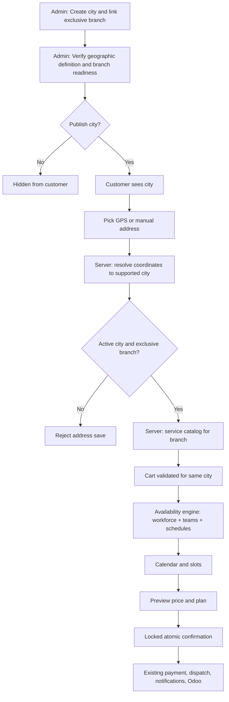

# NIRAB CLEAN — City-One-Branch | الخطة التنفيذية الكاملة للوكيل
> نسخة موحدة تحتوي نص ملفات التنفيذ الـ16 كاملة بالترتيب، وليست مصدر كود منفذ.
> للتنفيذ ابدأ من 00-START-HERE ثم التزم بمراحل CITY-01 إلى CITY-09؛ لا تشغّل الإنتاج أو أي ترحيل تلقائي.
## فهرس الملفات
- `00-START-HERE.md`
- `01-ARCHITECTURE-DECISIONS.md`
- `02-SOURCE-AUDIT.md`
- `03-DATA-MODEL-MIGRATION.md`
- `04-GEO-VALIDATION.md`
- `05-ADMIN-CITY-OPERATIONS.md`
- `06-SERVICE-CATALOG-CART.md`
- `07-BOOKING-AVAILABILITY.md`
- `08-CUSTOMER-FLUTTER.md`
- `09-PROVIDER-SERVICEMAN.md`
- `10-API-CONTRACTS.md`
- `11-QA-ACCEPTANCE.md`
- `12-RELEASE-ROLLBACK.md`
- `13-PHASES-AND-DELIVERABLES.md`
- `14-EDGE-CASES-AND-INVARIANTS.md`
- `15-FINAL-AGENT-COMMAND.md`

---

<!-- BEGIN 00-START-HERE.md -->
# NIRAB Clean | CITY-ONE-BRANCH — تعليمات البدء الملزمة للوكيل

> **نوع التسليم:** خطة تنفيذ قابلة للتطبيق على مستودعات NIRAB الحالية (Laravel / Flutter)، وليست تقريرًا يفيد بأن التنفيذ تم.  
> **قرار العميل النهائي:** الإدارة تتحكم في المدن الظاهرة، لكل مدينة فرع واحد حصري، الفرع يغطي كامل المدينة، لا مناطق تغطية مرسومة للفرع، لا يجوز حفظ عنوان خارج مدينة مدعومة، الخدمات والمواعيد لا تُعرض باعتبارها قابلة للحجز إلا بعد التحقق من القدرة الفعلية.  
> **المرجع الزمني:** 13 نوفمبر 2026.  
> **بيئة التشغيل المستهدفة:** Laravel + MySQL 8 Spatial، Flutter (عميل ويب/Android وتطبيقات فرع/فني)، بنية NIRAB الحالية على Dokploy. لا تغيّر التقنية أو المحرك المالي.

## أمر البدء — انسخه للوكيل

أنت الوكيل المنفذ لتغيير معماري تدريجي باسم `NIRAB-CITY-ONE-BRANCH`. افحص أحدث مصادر **جميع المستودعات الفعلية** قبل تعديل أي ملف؛ التقارير السابقة سياق لا إثبات لصحة أحدث نسخة. اقرأ ملفات هذه الحزمة بالترتيب وابدأ بـ `02-SOURCE-AUDIT.md`، وثّق نتائجك، ثم نفذ مراحل `13-PHASES-AND-DELIVERABLES.md` بالترتيب مع المحافظة على التوافق مع الحجوزات والمدفوعات التاريخية. لا تستبدل محرك إتاحة حقيقي بمحاكاة، ولا تُبسط الحراسة المالية أو الأقفال. اقرأ قيود التشغيل أدناه حرفياً. عند التعارض، اعتبر متطلبات السلامة والبيانات والتوافق أهم من سهولة التعديل؛ سجّل الحاجز واستكمل الأجزاء الآمنة دون ادعاء أن النظام جاهز للإنتاج.

## ملفات الحزمة وترتيب القراءة

1. `00-START-HERE.md` — المهمة والقيود وتعريف الإنجاز.
2. `01-ARCHITECTURE-DECISIONS.md` — السياسات والسيناريوهات والمخطط المنطقي.
3. `02-SOURCE-AUDIT.md` — جرد التبعيات قبل التعديل وإثبات عدم وجود تعارضات.
4. `03-DATA-MODEL-MIGRATION.md` — نموذج المدن والعلاقة الحصرية مع الفروع وترحيل آمن.
5. `04-GEO-VALIDATION.md` — الحدود الجغرافية، تحقق العناوين، منع مدن غير مدعومة.
6. `05-ADMIN-CITY-OPERATIONS.md` — لوحات الإدارة ومعالج النشر والجاهزية.
7. `06-SERVICE-CATALOG-CART.md` — ظهور الخدمات وشروط السلة والتسعير.
8. `07-BOOKING-AVAILABILITY.md` — المواعيد والتكرار والإسناد والدفع.
9. `08-CUSTOMER-FLUTTER.md` — واجهات العميل Android/Web وحالاتها.
10. `09-PROVIDER-SERVICEMAN.md` — توافق تطبيق مدير الفرع والفني.
11. `10-API-CONTRACTS.md` — عقود API وأكواد الرفض والتوافق.
12. `11-QA-ACCEPTANCE.md` — سيناريوهات اختبارات المصدر والقبول اليدوي.
13. `12-RELEASE-ROLLBACK.md` — إعداد البيانات والطرح التدريجي والتراجع.
14. `13-PHASES-AND-DELIVERABLES.md` — مراحل التنفيذ وملفات النتائج لكل مرحلة.
15. `14-EDGE-CASES-AND-INVARIANTS.md` — حالات الحواف والثوابت التي لا يجوز كسرها.
16. `15-FINAL-AGENT-COMMAND.md` — أمر تنفيذي مختصر وقائمة التسليم الإلزامي.

## قرارات ثابتة لا تتغير دون موافقة صاحب المشروع

- النظام **شركة واحدة** ذات فروع، وليس Marketplace. `Provider` يمثل فرعًا و`Serviceman` فنيًا، كما هو حاليًا.
- مدينة مفعّلة = مدينة وافقت عليها إدارة نيراب، ذات هوية جغرافية قابلة للتحقق، مرتبطة بفرع واحد **منشور وجاهز لاستقبال أعمال جديدة**. لا تعرض مدينة لمجرد وجود سجلها.
- لكل مدينة فرع واحد حصري، ولكل فرع مدينة واحدة حاليًا. أعطِ قاعدة البيانات قيودًا حقيقية لا تعتمد على الواجهة فقط.
- الفرع يغطي المدينة كاملة. **لا تطلب من الإدارة رسم Polygon لتغطية الفرع**. حدود المدينة (إن لزم التحقق بالإحداثيات) مرجع جغرافي مركزي ولا تُعد منطقة فرعية للفرع.
- لا يعتمد قرار أهلية العنوان على نص المدينة المرسل من العميل أو اختيار مدينة في Flutter؛ Backend يتحقق من الإحداثيات والمصدر الجغرافي المعتمد.
- لا يُنشئ أو يحدّث عميل عنوانًا جديدًا في مدينة غير متاحة، حتى إذا حاول تجاوز الواجهة باستدعاء API مباشر. البيانات التاريخية لا تُحذف تلقائيًا.
- يُستخرج الفرع من المدينة في Backend ولا يعتمد `provider_id` المرسل من العميل كمرجع مطلق؛ المسارات القديمة تحافظ على التوافق الموثق.
- يجب الفصل بين (أ) المدينة/الفرع المفعّل، (ب) جاهزية خدمة أساسيًا، (ج) توافر موعد محدد، (د) تحقق الحجز النهائي الذري.
- كتالوج رئيسي للخدمات، وأهلية تشغيلية على فرع المدينة. `quote` تبقى بطلب عرض سعر؛ لا تخلطها بخدمات `fixed`.
- تقويم Inline يعرض حالة أيام حقيقية ولا يخترع مواعيد؛ حجز متكرر صالح فقط إذا خُطّط لجميع زياراته معًا.
- احتفظ بالحجوزات والمدفوعات القديمة، وأرقامها، ولقطات الأسعار، وواجهات إشعاراتها والفوترة وOdoo، ولو كانت أصلاً مقسمة على عدة فروع.

## نطاق التنفيذ

**داخل النطاق:** Laravel Modules + الإدارة، قاعدة البيانات ومهاجرات additive، API، Customer Flutter Web/Android، توافق Provider/Serviceman، أدوات فحص/ترحيل قراءة فقط، ترجمات AR/EN، فحوص خفيفة، تقارير لكل مرحلة، خطة نشر وRollback.

**خارج النطاق:** حذف بيانات إنتاجية، نشر تلقائي للإنتاج، تشغيل migrations إنتاجية، إعادة تصميم الدفع، تغيير MySQL إلى PostgreSQL، إنشاء Microservices، إعادة بناء كل واجهات NIRAB، تغيير صلاحيات أنظمة قائمة دون مبرر، تحويل جميع المدن الحالية إلى نشطة افتراضيًا، رسم مناطق للفرع، أي اعتماد على بيانات جغرافية غير موثوقة مع قبول صامت.

## قواعد تشغيل ملزمة

1. **لا تشغّل بيئة إنتاج ولا تُجرِ تغيرًا على بياناتها**؛ لا Docker، لا عمليات استيراد فعلية، لا migrations، لا seeders، لا إرسال SMS/FCM أو دفع حقيقي. اكتب السكربتات والخطوات دون تنفيذها.
2. فحوص المصدر الخفيفة فقط حيث تتوفر الأدوات والاعتماديات: `php -l`، `git diff --check`، `dart format --output=none --set-exit-if-changed`، `flutter analyze` محدد عند توفر حزم، اختبارات وحدة صغيرة/معزولة. إذا غابت الأدوات اذكر ذلك ولا تدّعِ النجاح.
3. لا تستخدم أسرارًا أو Tokens حقيقية في ملفات التقرير. لا تغيّر الـ`.env` الإنتاجي.
4. تغييرات معمارية مهاجرات **إضافية** مع Backward Compatibility. لا Drop/rename مباشر لحقول `zones`, `providers`, `bookings`, `branch_service_areas` أو علاقات كانت تستخدمها الحجوزات القائمة.
5. امنع `SELECT *` المتكرر وN+1 والحساب غير المحدود. ضع حدودًا للصفحات والأيام والفروع ووقت الاستجابة، وعالج الفشل منفصلًا عن نفاد المواعيد.
6. احفظ كل تغييرات الفرع والمدينة والصلاحيات في Audit Log؛ لا تسمح لمدير الفرع بتفعيل مدينة أو تغيير ربطها.
7. لا تنشئ خدمة حساب جاهزية ثانية تختلف عن `DirectServicePolicy` و`AvailabilityService` و`BranchCapacityPolicy` و`BranchCheckoutService`؛ أنشئ Adapter/Facade تجمعها فقط.
8. لا تغيّر استجابة API قديمة بصورة كاسرة دون توثيق وإدارة نسخ؛ أضف حقولًا/مسارات جديدة عند الحاجة.
9. لا تقدم «تم 100%» إلا إذا كانت كافة الثوابت والمراجعات ناجحة، وميّز مصدرًا مكتملًا عن اختبار وتشغيل لم يُنفّذا.
10. المطلوب تنفيذ المراحل المتسلسلة فعليًا في المصادر، وليس إنشاء وثائق فقط، مع تقارير `CITY-XX-REPORT.md` بعد كل مرحلة.

## تعريف الإنجاز

يُعد **الكود جاهزًا للمراجعة** إذا: تمت مراحل CITY-01..CITY-09 بالمستودعات الصحيحة، ونجحت الفحوص الساكنة المسموحة، وتطابقت عقود API/ترجمة الرسائل، وأُنجزت خطة البيانات والتوافق والتراجع. ويُعد **جاهزًا للإنتاج** فقط بعد نشر تجريبي معتمد، تشغيل migrations آمن بإذن المسؤول، معايرة الحدود، وتنفيذ مصفوفة القبول الحقيقية دون كسر الحجز والدفع.

<!-- END 00-START-HERE.md -->

---

<!-- BEGIN 01-ARCHITECTURE-DECISIONS.md -->
# CITY-01 | وثيقة القرارات والمعمارية المستهدفة

## الهدف التجاري

العميل لا يختار Branch أو Zone أو Coverage Polygon. يختار مدينة مدعومة، ثم عنوانًا دقيقًا داخلها، ثم خدمة/خدمات؛ النظام يستنتج الفرع الحصري للمدينة، ويتحقق من أهلية الخدمة والفنيين والفرق والمواعيد والسعة قبل التأكيد. لا يُقبل حفظ عنوان لمدينة غير متاحة. الإدارة وحدها تحدد المدن الظاهرة وتربط المدينة بفرعها.

## النموذج الإداري

- `City`: كيان مدعوم من إدارة نيراب، `draft|active|paused|retired`، له هوية جغرافية وحدود أو مرجع تحقق معتمد؛ اسم عربي/إنجليزي للعرض فقط.
- `City -> Branch`: تعيين حصري واحد لواحد. الفرع مشتق من المدينة لا من اسم المستخدم أو أقرب فرع.
- `Branch`: هو `Provider` الحالي؛ حالة الاعتماد/النشر/`intake_enabled` والتجهيز التشغيلي تبقى حراسًا فعليين.
- `Catalog Service`: خدمة مركزية؛ `branch_service_permissions` الحالية تتحكم في سماح الإدارة وتفعيل الفرع، مع متطلبات تنفيذ مستقلة.
- `Technician/Team`: موظفو فرع واحد، Skills/Shifts/Leaves/Assignments تفحص فعليًا عند الجدولة.
- `Address`: مرتبط بـ `city_id`, إحداثيات مثبتة، ونتيجة التحقق؛ لا يتطلب ربطًا ثابتًا بالفني أو الحجز.
- `Cart`: مرتبط بسياق مدينة واحدة وعنوان صحيح؛ لا خلط بين مدينتين.
- `Booking`: فرع المدينة ثابت في snapshot المعتمد لكل حجز جديد، مع إعادة تحقق نهائي وضوابط منع التداخل.

## أربع درجات للإتاحة — لا تخلطها

| المستوى | السؤال | متى يُحسب | أثره |
|---|---|---|---|
| `city_bookable` | هل المدينة مفعّلة والفرع يقبل عملًا جديدًا؟ | قائمة المدن والعناوين | إظهار/منع اختيار المدينة وحفظ عنوان جديد |
| `service_configured` | هل الخدمة مُصرح بها ومهيأة بالفرع وبها مؤهلات كافية من حيث التكوين؟ | الكتالوج | خدمة قابلة للاستكشاف/الحجز أو غير قابلة للحجز |
| `time_available` | هل يوجد موعد يحقق مدة وورديات/إجازات/حجوزات/سعة؟ | يوم/ساعة | عرض Slots حقيقية |
| `commit_allowed` | هل الاستحقاق والسعة والسعر والخطة ما زالت صحيحة لحظة الحجز/الدفع؟ | المعاينة النهائية والتأكيد | حجز ذري أو رفض 409/422 دون حجز جزئي |

مهم: غياب موعد اليوم ≠ غياب جاهزية للخدمة. وجود خبير في قائمة الفنيين ≠ توافره الآن. فتح الفرع ≠ صلاحية كل خدمة تلقائيًا.

## التسلسل المعماري



## معمارية التطبيق — Modular Monolith

1. `CityRegistry`: سجلات المدن، حالات التفعيل، حدود المدينة، مسارات النشر/الإيقاف والتدقيق.
2. `CityResolver`: حل موقع العميل إلى مدينة واحدة مؤكدة؛ يعيد سبب رفض قابل للترجمة ولا يفترض اعتماد نص `locality` وحده.
3. `CityBranchResolver`: الفرع الواحد المرتبط بالمدينة والمصرح باستقبال طلبات جديدة؛ fail-closed عند فقد/ازدواج/تعطيل الربط.
4. `CityServiceabilityFacade` (منسق لا محرك جديد): يستعمل `DirectServicePolicy`, `BranchReadinessService`, `ServiceItemRequirements`, `AvailabilityService`, `BranchCapacityPolicy` ويعيد Decision DTO واحدًا بحسب مستوى التحقق.
5. `SingleCityCheckoutAdapter`: يحافظ على `BranchCheckoutService`, `DirectBookingReservationGuard`, snapshots, payment/API contracts؛ يعطل التخطيط متعدد الفروع للحجوزات الجديدة حين feature flag مفعّل دون حذف مسارات legacy.
6. `CalendarAvailability`: يعيد استخدام قرار الإتاحة لنطاق أيام محدود، والنتائج لا تحجز وقتًا ولا تمثل وعدًا ثابتًا.

## قواعد UX

- أول تشغيل: قائمة مدن منشورة مؤهلة + تحديد موقع اختياري بإذن العميل؛ لا يحتاج تسجيل حساب لاستكشاف المدن.
- قبل حفظ عنوان/إضافة سلعة: مدينة مختارة وعنوان تم التحقق منه Server-side.
- عند تبديل المدينة، وضّح تبعات السلة والتسعير والمواعيد، لا تمسح بصمت.
- الصفحة الرئيسية تعرض خدمات فرع المدينة القابلة للتكوين، لا كل خدمات الكتالوج المركزي.
- خدمة انشغل فنيها مؤقتًا: لا تختفي؛ تظهر أيام مستقبلية إن وجدت.
- خدمة بلا فريق مؤهل أو فرع غير جاهز: لا تُقدم كقابلة للحجز، وقد تظهر للاطلاع فقط وفق سياسة المنتج الواضحة.
- `fixed`: أضف للسلة بعد التحقق الأساسي؛ `quote`: طلب عرض سعر مستقل، دون سعر نهائي أو موعد مؤكد وهمي.
- الأخطاء: لا تخلط Offline/Timeout مع `no_slots` أو `city_unsupported`.

## ثوابت مالية وتاريخية

- لا إعادة توزيع صامتة لحجوزات مدفوعة أو مقبولة.
- لا تغيير دون موافقة للـ snapshot/total/discount/wallet/VAT/gateway/Odoo event keys.
- `booking_id` و`bookings[]` القديمتان تبقيان متوافقتين؛ الحجوزات القديمة متعددة الفروع تبقى قابلة للعرض والمتابعة والاسترداد.
- الفروع القديمة التي لها `capacity=0` لا تُرفع سعتها تخمينًا؛ حافظ على التوافق واطلب تهيئة صريحة للفروع الجديدة.
- وقت السعودية `Asia/Riyadh` مرجعي للعرض والحجز؛ لا تولّد مواقيت من timezone جهاز المستخدم.

## لا تفعل

- لا تكتب `where('city_name', 'الرياض')` كأساس أمني أو مالي.
- لا تجعل Places Autocomplete يعيد نص المدينة فيصبح عنوانًا مؤهلًا فورًا.
- لا تجعل وجود فرع في الرياض يثبت القدرة على تنفيذ خدمة معينة غدًا.
- لا تبنِ محرك سعة جديدًا مستقلًا أو تزيل `DispatchEngine`.
- لا تُصلح عرض الخدمات في Flutter فقط وتترك API السلة يقبل الطلب غير المؤهل.

<!-- END 01-ARCHITECTURE-DECISIONS.md -->

---

<!-- BEGIN 02-SOURCE-AUDIT.md -->
# CITY-02 | تدقيق المصادر أولًا (Gate A)

**حالة المرحلة:** إلزامية قبل أي migration أو تغيير API. التقارير السابقة لا تكفي لإثبات الكود المنشور حاليًا.

## افتح مستودعات NIRAB الفعلية

- Backend / Admin Panel (Laravel)، User app and web (Flutter)، Provider app (Flutter)، Service man app (Flutter).
- افحص `git status -sb`, الفرع و`HEAD`, حالة التزامن مع `origin/main` إن أمكن دون تعديل شجرة العمل؛ لا تفترض أن النسخة القديمة في zip هي الأحدث.
- أبلغ عن تغييرات محلية غير مدفوعة وحافظ عليها؛ لا `git reset --hard` ولا `git clean -fd` ولا squash أو force push دون طلب صريح.
- سجل شجرة Routes الفعلية، إصدارات Flutter/Laravel، حالة feature flags، migrations الموجودة، أية تغييرات حساسة سبق تنفيذها.

## ملفات مرشحة للفحص (أسماء معروفة تاريخيًا؛ ثبّت المسار الموجود)

| المجال | مرشح مراجعة |
|---|---|
| الخدمة | `Modules/ServiceManagement/Services/DirectServicePolicy.php`, `BranchServiceAvailabilityService.php`, `ServiceItemRequirements`, `ServicePriceResolver` |
| الفرع | `Modules/ProviderManagement/Services/BranchReadinessService.php`, `BranchCapacityPolicy.php`, `BranchIntakePolicy.php`, `BranchOnboardingService.php`, `BranchZoneChangeService.php` |
| الإتاحة | `Modules/BookingModule/Services/AvailabilityService.php`, `DispatchEngine.php`, `DirectBookingReservationGuard.php` |
| السلة والحجز | `Modules/CartModule/Http/Controllers/Api/V1/Customer/CartController.php`, `Modules/BookingModule/Services/BranchCheckoutService.php`, `CheckoutBranchGroupingService.php` |
| Customer APIs | `Modules/BookingModule/Http/Controllers/Api/V1/Customer/DispatchController.php`, `BookingController.php`; ومتحكمات خدمة/منطقة وعناوين العملاء الفعلية |
| الإدارة | `app/Http/Controllers/BranchOnboardingController.php`, `Modules/ProviderManagement/Http/Controllers/Web/Admin/ProviderController.php`, Views إدارة الفرع |
| Flutter | `lib/feature/checkout/.../service_schedule.dart`, `available_slot_picker.dart`, `daily_repeat_booking_schedule.dart`, `weekly_repeat_booking_schedule.dart`, `custom_repeat_booking_schedule.dart`, `lib/helper/checkout_helper.dart`, Customer home/services/cart/address controllers |
| التوافق المالي | `Modules/PaymentModule/...`, `Modules/CustomerSubscriptionModule/...`, Odoo AccountingEvents, notification callbacks |

ملحوظة: وجود أسماء الملفات في تقرير قديم لا يثبت وجودها بالحالة نفسها الآن؛ ابحث عن النظير الفعلي بدل إنشاء ملفات مكررة.

## أسئلة تدقيق يجب إجابتها مع أدلة ملف:سطر

### جغرافيا وبيانات

1. هل `zones` الحالي يمثّل مدنًا بالفعل أم مناطق تشغيل أوسع؟ وهل توجد Zone واحدة للرياض وأخرى لجدة؟
2. هل `zone_id` مستخدم في pricing/coupon/cart/quote/address/booking/payment/favorites/Provider APIs؟ أحصِ كل موضع.
3. هل هناك بيانات boundaries معتمدة للمدن يمكن إعادة استعمالها؟ وما مصدرها ونظام إحداثياتها؟
4. ما هي كل الطرق التي تحفظ/تعدل عناوين العميل، بما فيها guest/registered/legacy/admin/checkout؟
5. أين تُخزن الخدمة في موقع العميل `service_address`, و`zone_id`, `provider_id`, `branch_service_area_id`؟
6. هل توجد جداول متعددة `cities`, `areas`, `zones` ذات معان متداخلة؟ ما هو مصدر الحقيقة المطلوب؟

### الأعمال والتشغيل

7. هل `DirectServicePolicy::catalog` يفحص النشر فقط أو فرع المدينة الفعلي؟
8. هل `CartController` يسمح بإضافة الخدمة بلا `provider_id` ثم يفحص وقت Checkout فقط؟
9. أين يُحسب `required_technicians`, `execution_type`, team membership, shifts, leaves, duration, travel buffer؟
10. هل الجدولة الفردية والمتكررة تستخدمان نفس planner؟ كيف يتعامل `available_slot_picker` مع اختلاف provider بين الأيام؟
11. هل `BranchCheckoutService` قد يولد عدة bookings للفروع؟ ما الحارس الذي يعيد فحص السعة لحظة التأكيد؟
12. هل الإدارة الحالية تنشئ `branch_service_permissions` تلقائيًا عند إنشاء الخدمة؟ وهل migration 2026-11-08 الخاصة بالتوريث نُفذت؟ هل عامل `branch-services` يعمل في الإنتاج؟ **لا تستعلم عن الإنتاج أو تغيره دون إذن**؛ أبلغ عن المتطلبات.

### Customer / Provider / Serviceman

13. من أين تأتي قائمة خدمات الرئيسية وهل يملك Flutter Address/City Context موحدًا؟
14. كيف تُخزن city/zone المختارة في Flutter؛ ما إبطال cache عند تغيير العنوان أو الكمية أو نوع الزيارة؟
15. ما مسارات Provider المسموح فيها تغيير الفرع وHours/Shifts/Teams؟
16. كيف يتعامل الفني مع موعد من فرع قديم أو طلب مدفوع بعد إيقاف المدينة؟

## مخرجات Gate A

أنشئ `reports/CITY-01-SOURCE-AUDIT.md` ويجب أن يحتوي على:

- SHA/branch/dirty state لكل مستودع، قائمة الأوامر المنفذة فقط.
- جدول `Current path -> Current behavior -> Desired behavior -> Risk -> Proposed change` مدعوم بأماكن المصدر.
- مصفوفة `zones/provider/area` (القيود والفهارس والتبعيات)، وقرار **كيف نحافظ على Zone legacy**.
- قائمة نقاط الدخول الخاصة بحفظ العنوان وإضافة السلة وCheckout والتكرار والـQuote.
- تحليل اصطدام المهاجرات ووجود جدول مدن سابق؛ لا تنشئ جدولًا ثانياً إن وُجد ما يكافئه.
- قرار حول مرجع حدود المدن؛ إن كان غير متاح، صنّف ذلك كـ **حاجز نشر**، لا تعتمد تطابق الاسم النصي مكانه.
- خطة تغيير مرحليّة لا تمس تاريخ المال أو الحجوزات.

**معيار الخروج:** لا يبدأ تنفيذ CITY-02 قبل إثبات فهم مواضع حفظ/إدارة العنوان، ومرجع zone، وعقود cart/checkout، وكيفية تعريف حدود المدينة بأمان.

<!-- END 02-SOURCE-AUDIT.md -->

---

<!-- BEGIN 03-DATA-MODEL-MIGRATION.md -->
# CITY-03 | نموذج البيانات والقيود والترحيل الآمن

## مبدأ التصميم

استعمل الجداول الحالية للـProvider/Services/Cart/Booking، ولا تنشئ نسخًا موازية من Entity موجودة. أضف **سجل مدن قانوني/تشغيلي** ومستوى تحقق العنوان. القرار النهائي للأعمدة يعتمد على Gate A، لكن يجب أن يحفظ الثوابت الآتية. الترحيلات مكتوبة فقط؛ لا تُنفّذ على الإنتاج بوساطة الوكيل.

## A. City Registry (مقترح اسمي)

`cities` (إذا لم يوجد ما يكافئه حرفيًا ويمكن ترقيته بأمان):

| الحقل | النوع/القاعدة |
|---|---|
| `id` | UUID، مفتاح أساسي (مطابق لأسلوب المشروع) |
| `country_code` | `SA`، مع تصميم يسمح GCC لاحقًا دون تفعيل مدن خارج السعودية الآن |
| `canonical_code` | رمز جغرافي ثابت من المصدر، فريد ضمن البلد |
| `name_ar`, `name_en` | أسماء عرض؛ ليست مفاتيح تحقق |
| `administrative_level` | `city`، ليس province/region |
| `timezone` | `Asia/Riyadh` حاليًا |
| `status` | `draft/active/paused/retired`، default `draft` |
| `geo_verification_status` | `unverified/verified/review_required` |
| `boundary_version_id` | مصدر تعريف حدود المدينة المعتمد إن كان به جدول منفصل |
| `legacy_zone_id` | nullable/FK أو mapping بديل يُقرّ بعد Gate A؛ الحفاظ على التوافق |
| `published_at`, `published_by`, `paused_at` | توقيت وفاعل التغيير، مع Audit Log مستقل |
| timestamps | حسب أعراف Laravel |

الرمز `canonical_code` لا يخترع من اسم المستخدم؛ يُربط ببيانات إدارية/جغرافية معتمدة. يمنع تكرار نفس المدينة بأسماء لغوية مختلفة.

## B. جدول حدود المدينة

`city_boundary_versions` أو جدول مطابق لتصميم المشروع:

- `id`, `city_id`, `geometry` من نوع POLYGON أو MULTIPOLYGON وفق المصدر، SRID 4326 **بعد التحقق من دعم MySQL الفعلي**.
- `source_name`, `source_reference`, `source_license`, `source_date`, `imported_at`, `reviewed_by`, `checksum`, `version`, `status`.
- حد **نسخة واحدة منشورة** لكل مدينة؛ نسخ Draft تحفظ لمراجعة التغيير. تغيير الحدود يخضع لمعاينة أثر على عناوين/حجوزات مستقبلية.
- Check geometry validity، bounds، SRID، ثبات Longitude/Latitude، فهرس مكاني حيث يدعمه schema، ولا تسمح import غير موثوق.
- لا تخترع شكل المدينة من rectangle أو circle ولا تحوّل Polygon خدمة فرع قديم تلقائيًا إلى حدود مدينة.

## C. الربط الحصري للمدينة والفرع

`city_branch_assignments` كجدول **التعيينات الحالية فقط**:

- `id`, `city_id` NOT NULL UNIQUE, `provider_id` NOT NULL UNIQUE، `assigned_by`, `assigned_at`, timestamps.
- مفتاحان Foreign Key إلى cities/providers مع `ON DELETE RESTRICT`، لا cascade على الحجوزات أو المال.
- يدعم انتقال الفرع بإزالة/تعديل السجل الحالي داخل Transaction مقفل مع كتابة Audit مستقل (لا تحتفظ بصفوف تاريخية داخل نفس الجدول الفريد).
- قرار إعادة تعيين مدينة بفرع آخر إذا فيها حجوزات مستقبلية **محجوز/مدفوع**: يُمنع تلقائيًا ويُحال إلى إجراء إدارة مع أثر وتأكيد وحفاظ على الفرع الأصلي لكل حجز. لا تعدل `bookings.provider_id` رجعيًا.
- إذا اختير إضافة `city_id UNIQUE` إلى `providers` بدلاً من جدول الربط بعد Gate A، أثبت المعنى نفسه (current-only + audit + historical immunity) ولا تجمع مع جدول علاقة متناقض.

## D. عنوان العميل

- افحص جدول عنوان العميل الموجود وأضف `resolved_city_id` (أو `city_id` في موضع موحد) nullable في مرحلة التوافق، `location_verified_at`, `city_boundary_version_id` أو `verification_source` حسب الحاجة.
- لا تعتبر `zone_id` المرسل من Flutter مصدراً للثقة؛ Back-end يحله من `city_id`/عنوان محفوظ معاد التحقق منه.
- لا تحفظ عنوانًا جديدًا إلا إذا: Coordinates صحيحة + تقع داخل **مدينة واحدة** منشورة قابلة للخدمة + الفرع المربوط صالح وفق policy.
- لا تحذف عناوين سابقة تقع خارج تغطية جديدة؛ ضع حالتَها `unsupported_or_revalidation_required` في الاستجابة/API دون محوها.
- عند تغيّر الحدود أو إيقاف المدينة: لا تعدّل عنوان العميل صامتًا؛ أبطل صلاحيته لإنشاء حجز جديد حتى إعادة التحقق.

## E. Cart / Snapshot / Booking

- لا تضف `provider_id` متناقضًا يختاره العميل؛ استخدم resolution ثابت من city في context؛ أبقِ الحقول القديمة للتوافق عند الحاجة.
- حفظ context واحد للسلة الجديدة `city_id`, `address_id`, `branch_id`, `context_revision` على مستوى checkout/session/snapshot وفق schema القائم (لا تضاعف state بلا داع).
- Snapshot يضم city/branch/zone/version/price/items/visits والملكية/المدة/التوقيع كالموجود، كي لا تتبدل الخطة بعد الموافقة.
- أضف حقل City لبيانات الحجز الجديدة فقط إذا كان مفيدًا وليس بديلًا لـ `provider_id`؛ احتفظ بالأرشفة والأرقام ومسار الدفع القديم.
- إن كانت DB حالياً تحفظ `bookings` لعدة فروع، لا تدمجها ولا تُعد كتابة نتائج الدفع القديمة.

## F. علاقة Zone الحالية

- حافظ على `zone_id` كطبقة توافق حتى الانتهاء من جميع Pricing/Cart/Booking/Payment/Quote flows.
- إذا كان لكل مدينة Zone تشغيلية واحدة: اربط mapping فريدًا صالحًا، ووثقه وقيده حسب النظام.
- إذا كانت Zone مشتركة لمدن أو مجزأة: لا تُجبر على mapping خاطئ؛ أنشئ mapping explicit مع اختيار pricing zone مضبوطة بالتعريف، واختبر الضرائب والقسائم والعروض. لا تخمّن زونًا من الفرع الأقرب.
- لا تمس `branch_service_areas` القديمة في سجلّات الحجز؛ أزل اعتماد **الحجوزات الجديدة في city mode** عليها بعد التطابق.

## خطة migrations دون تنفيذ

1. Migration additive لجدول المدن/العلاقة/الحدود (أو extend existing وفق Gate A).
2. Migration nullable لحقول العنوان الجديدة وأية فهارس.
3. Migration لعلاقات أو قيود فريدة بعد معالجة التكرارات في بيانات الاختبار؛ لا تضف `UNIQUE` قبل تقرير توافق البيانات.
4. أمر Artisan `nirab:city-audit --dry-run` يعرض مرشحي المدن والفروع ومشاكل التداخل واليتامى والازدواج، **قراءة فقط**.
5. أمر `nirab:city-backfill --dry-run` ثم `--apply --confirm ...` خارج نطاق تنفيذ الوكيل الفعلي؛ يجب بناء قواعد آمنة، ولا تجعل التنفيذ الافتراضي `apply`.
6. لا تُحوّل كل الفروع تلقائيًا إلى مدن منشورة؛ الرياض وجدة مرشحتان تحتاجان مراجعة تعريف الحدود وربط الفرع وتوافق الخدمات.

## فحوص سلامة البيانات

- لا يوجد أكثر من branch حالي للمدينة ولا أكثر من city حالية للفرع.
- لا مدينة `active` دون حدود verified أو آلية تحقق بديلة موثوقة معتمدة ودون فرع صالح.
- لا ازدواج أسماء يُخفي مدينة مختلفة.
- لا عنوان جديد `verified` خارج مدينة صالحة.
- لا تزامن متعارض عند طلبين يربطان الفرع نفسه في الوقت نفسه: استعمل DB unique+transaction والتقاط conflict.
- لا `ON DELETE CASCADE` يطال Bookings/Payments/Addresses.

## مخرجات المرحلة

تقرير `CITY-02-DATA-REPORT.md`: مخطط حقول وفهارس نهائي قبل/بعد، ملفات migration الجديدة، شرح `up/down`, سياسة legacy، dry-run outputs **على fixtures فقط**، والقيود أو حالات الحظر للنشر.

<!-- END 03-DATA-MODEL-MIGRATION.md -->

---

<!-- BEGIN 04-GEO-VALIDATION.md -->
# CITY-04 | حدود المدن والتحقق الآمن من عنوان العميل

## هدف لا يقبل الالتفاف

لا يُنشأ عنوان جديد ولا يُفعّل عنوان للاستخدام في حجز جديد إذا كانت إحداثياته خارج **مدينة مدعومة فعليًا**. ولا يُقبل موقع لأن Flutter اختار `city_id`، أو لأن عنوان Google نصه `Riyadh`، أو لأن `zone_id` أُرسل يدويًا.

## مصدر الحدود — Gate Geo قبل النشر

1. احصر مصادر حدود المدن المتاحة مع اسم الجهة والوثيقة/الترخيص وتاريخ التحديث والمستوى الإداري (City لا Province).
2. استورد المرجع المصرح باستخدامه *بأداة إعداد آمنة* إلى Geometry SRID 4326. لا تفترض أن Google Places/Geocoding يعيد Polygon مدن قانونيًا/دائمًا.
3. احفظ النسخة والمصدر والتحقق والتوقيع/checksum مع كل import، وراجع الشكل وتداخله مع المدن الأخرى.
4. إذا لم توجد حدود معتمدة أو مرجع بديل يحقق إثبات الانتماء للمدينة، أوقف **نشر المدينة وحفظ عناوينها** مع `GEO_SOURCE_NOT_APPROVED`؛ لا تعتمد صندوقًا مستطيلاً أو radius أو نص `locality` بوصفه دليلًا مساويًا للحدود.
5. لا تطلب من مسؤول الفرع رسم منطقة؛ هذه بيانات مركزية تُحمّل من مرجع معتمد. عرض خريطة الحدود للإدارة read-only للمراجعة مسموح.

## دالة حل الموقع المقترحة

`resolve(LocationPoint, expectedCityId?) -> LocationResolution`

- تحقق من `lat ∈ [-90,90]`, `lng ∈ [-180,180]`، عدم null/NaN، وبأن النقطة تمثل السعودية عندما يتطلب النطاق؛ لا تفترض اتجاه الإحداثيات.
- استعمل Spatial Query بمعنى النقطة داخل/على حدود المدينة؛ `ST_Contains` وحده قد يستبعد boundary، لذلك اختبر `ST_Intersects` أو المعادِل المدعوم في إصدار MySQL ومع SRID 4326 والبيانات الفعلية. ***لا تنس أن POINT يأخذ (longitude, latitude)*** وأن axis order في MySQL يستلزم اختبارًا صريحًا.
- افحص النسخة المنشورة الوحيدة لحدود المدن المؤهلة، لا جميع مدن غير منشورة.
- إذا تطابقت مدينة واحدة: أعد CityId + BoundaryVersionId + branch resolution، بلا تفاصيل فنيين.
- إذا تطابقت عدة مدن بسبب حدود متداخلة: `CITY_GEOMETRY_AMBIGUOUS` ويُمنع الحفظ، مع إشعار إداري ومراجعة مصدر البيانات.
- إذا لم تتطابق أي مدينة: `CITY_UNSUPPORTED`؛ إذا أخفق فحص DB/geo API: `LOCATION_VERIFICATION_FAILED` لا `unsupported`.
- إذا أرسل العميل expected_city غير المطابقة: `LOCATION_CITY_MISMATCH` مع city resolved لأجل اقتراح تغيير المدينة، **لا حفظ تلقائي**.
- قاعدة البيانات وسجل القرارات يدعمان مراجعة الحالات الملتبسة دون حفظ تفاصيل موقع حساسة في Logs.

## ثوابت منطقة/فرع المدينة

- `getEligibleCityByCoordinates` يتحقق من المدينة المنشورة والفرع الحصري المنشور و`intake_enabled` وسياسة الدعم، وعند عدم وجود خدمات مهيأة في المدينة لا يعتبرها متاحة للاستكشاف والحجز.
- لا يُربط الفرع باسم المدينة، ولا يتغير الفرع تلقائيًا بعد إنشاء حجز مؤكد.
- عند توقف مدينة عن استقبال حجوزات جديدة، تمنع إضافة عناوين جديدة وتُعاد فحوص أهلية العناوين السابقة عند checkout.
- عدم توافر Slot اليوم لا يمنع حفظ عنوان داخل مدينة متاحة ما دامت الخدمات مهيأة؛ فرق بين الاستقبال الأساسي والإتاحة الزمنية.

## مسارات كل العناوين

راجع وطبّق الحراسة عند: إنشاء عنوان مسجل/Guest، تحديث إحداثيات العنوان، تعيين عنوان افتراضي حين يدخل checkout، إدخال `service_address` الحر في checkout، عناوين من Places Autocomplete، طلب عرض سعر يتطلب زيارة، رفع عنوان من Admin/legacy إن كان يسمح بحجز جديد. **منع الواجهة وحده غير كافٍ**.

## واجهة Flutter

- تعرض المدن المتاحة من API فقط؛ لا hardcoded Riyadh/Jeddah.
- اختيار المدينة يدويًا يسمح بتصفح الكتالوج، لكنه لا يثبت أن أي نقطة في الخريطة داخلها.
- GPS اختياري بعد إذن صريح؛ إذا لم يمنح العميل إذن الموقع يستطيع البحث واختيار نقطة يدويًا.
- نتيجة تحقق فشل تظهر retry؛ `unsupported` تظهر رسالة «لا نقدم الخدمة بهذا الموقع حاليًا» ولا زر حفظ فعال.
- عند العثور على موقع في مدينة مدعومة مختلفة: اطلب موافقته على تبديل المدينة، ثم أعد تحميل الكتالوج والسلة.

## الأداء والأمان

- Geometry وCity Registry يتخزنان مع إصدارات، Spatial Index حيث يدعمه الـDB؛ لو دعم قاعدة بيانات نسخة geometry جغرافية بشكل خاص افحص compatibility قبل الاستعلام.
- ضع rate limiting للـguest، وتحكم في cache (الحدود ثابتة نسبيًا، ولكن حالة المدينة/الفرع يجب ألا تتأخر دون ضابط).
- `POST /customer/location/resolve` يعيد الحد الأدنى من المعلومات؛ لا معلومات فرق أو موظفين.
- سجلات العمليات تُخفي/تختصر الإحداثيات، وتلتزم بسياسات الخصوصية؛ لا ترسل عنوانًا كاملًا إلى أدوات analytics دون موافقة.

## اختبارات إلزامية ببيانات مرجعية

- نقطة ثابتة داخل الرياض، داخل جدة، خارج المدن، على الحدود، قريبة من الحدود، نقطة lat/lng مقلوبة، نقطة في Province الرياض خارج City الرياض.
- تداخل مدينتين يُرجع غموضًا لا المدينة الأولى عشوائيًا.
- مدينة draft/paused/retired رغم أن النقطة داخل حدودها لا تسمح بحفظ العنوان.
- إعادة ربط فرع/إيقاف intake بعد فتح واجهة العنوان يمنع الحفظ النهائي.
- إحداثيات صحيحة لكن اسم مكان مختلف: تعتمد هندسة المدينة الموثوقة لا النص.
- GIS timeout أو خطأ لا يتحول إلى `unsupported` ولا ينتج عنوانًا نشطًا.

## المخرجات

`CITY-03-GEO-REPORT.md` يذكر dataset/licensing/verification، إصدار MySQL Spatial المجرب في Fixtures، ومسارات الحفظ المحمية، وعقود الأخطاء، وفحوص الحدود. **غياب مرجع حدود موثوق = لا تصريح بالنشر، حتى لو كُتبت كل الشفرة.**

## مراجع فنية للتحقق أثناء التنفيذ

- Google Geocoding API — [Address Components](https://developers.google.com/maps/documentation/geocoding/guides-v3/requests-geocoding): مكونات العنوان متغيرة ولا يجب اعتبار `locality` إثباتًا حاسمًا للمدينة.
- MySQL 8.0 — [Spatial Index Optimization](https://dev.mysql.com/doc/refman/8.0/en/spatial-index-optimization.html): فهرسة SRID وتفسير SRS.
- MySQL 8.0 — [Creating Spatial Indexes](https://dev.mysql.com/doc/refman/8.0/en/creating-spatial-indexes.html): قيود Geometry وSpatial Index.

هذه المراجع لا توفر بذاتها حدود مدن سعودية مرخصة؛ يجب توفير dataset المدينة ومراجعة مصادرها في Gate Geo.

<!-- END 04-GEO-VALIDATION.md -->

---

<!-- BEGIN 05-ADMIN-CITY-OPERATIONS.md -->
# CITY-05 | لوحة إدارة المدن وربط الفروع والجاهزية والنشر

## المطلوب

أضف «إدارة المدن والتشغيل» ضمن لوحة NIRAB الإدارية القائمة، وأعد استخدام Branch Onboarding/Branch Workspace وAudit/Permission Services الحالية. لا تنشئ لوحة منعزلة أو تعيد مسار Marketplace.

## القائمة والشاشات

### شاشة «المدن»

- جدول بترقيم صفحات وبحث: الاسم AR/EN، الدولة، الحالة `draft/active/paused/retired`، الفرع الحالي، عدد الخدمات المهيأة، حالة الحدود، حالة الجاهزية، آخر تحديث، إجراءات مخولة.
- عرض المدن **غير المربوطة** للإدارة فقط، ولا تعرضها لـ Customer API.
- فلاتر: الحالة، الفرع، Geo Verified، ready، مدن بها حجوزات مستقبلية، ومدينة لا تملك فرعًا.
- قائمة المدخلات تعتمد على المصدر الجغرافي المعتمد لا على free-text city اسم فقط؛ منع ازدواج المكان العربي/الإنجليزي.

### إنشاء/تعديل مدينة

1. اختر city canonical record من dataset، اعرض municipality/province/country والحدود read-only.
2. احفظ Draft؛ تحقق من Conflict code/country/geometry overlap.
3. اختر فرعًا غير مرتبط بمدينة أخرى أو أنشئ فرعًا عبر Branch Onboarding الحالي.
4. لا تسمح بنقل فرع دون عرض أثر التغيير (حجوزات مستقبلية، عناوين، خدمات، إيرادات، صلاحيّات).
5. اعرض خدمات الفرع وسعرها ومتطلبات الفريق/الفنيين وتغطية كامل المدينة (تغطي كل المدينة بلا أي branch-specific area).
6. أعد استخدام محرر ساعات العمل والورديات والسعة والفرق الموجود؛ لا تنشئ إعداد Workforce مكررًا.
7. اربط الأذونات الحقيقية `branch_service_permissions`, `admin_enabled`, `is_active`، ولا تمنحها افتراضيًا استنادًا إلى اسم المدينة.

### تقرير الجاهزية

- ملخص يوضح: City Geo Verified، Exclusive Branch Attached، Branch Approved/Published/Intake Enabled، إعداد ساعات وسعة، عدد الخدمات المؤهلة، وجود سعر للخدمة الثابتة، متطلبات فريق/مهارات/ورديات.
- لكل خدمة: `ready | not_ready | requires_review` + `reason_codes[]` + الرابط الإداري الذي يصلح المشكلة.
- `no_active_technician`, `missing_skill`, `team_missing`, `branch_hours_missing`, `capacity_unconfigured`, `price_missing` وغيرها من `AvailabilityService::diagnose`/`BranchReadinessService`.
- أظهر أن إتاحة هذا اليوم ليست ضمانة لكل يوم/كمية/وقت؛ لا تجمع فحص يوم واحد لتعطي وعدًا دائمًا.

### Publish/Pause/Retire

- صلاحية نشر المدينة مستقلة، مركزية فقط؛ لا يكفي permission تعديل Branch.
- Publish داخل transaction وقفل على city+assignment+branch مع إعادة تحقق وفق أحدث حالة.
- يُمنع Publish إذا Geo غير معتمد، فرع مفقود/مكرر، Branch لم ينشر، intake مغلق، صفر خدمة مهيأة قابلة للاستكشاف، أو لازم prerequisites غير مكتملة.
- Pause/Retire يمنع الحفظ الجديد للعناوين/الحجوزات ويُخفي المدينة من قائمة المدن الجديدة، **دون إلغاء أو حذف الحجوزات السابقة**.
- تغيير Boundary Version/Branch Assignment للمدينة المنشورة يتطلب Impact Preview + confirmation token/hmac مؤقت يثبت الأثر والقيم التي وافق عليها المسؤول؛ إعادة الفحص عند confirm.
- Logs: actor_id, city_id, old/new state, assignment, reason, timestamp, boundary version، دون نشر بيانات العملاء.

## صلاحيات RBAC

| الدور | عرض المدن | إضافة/تحرير | ربط الفرع | نشر/إيقاف | تشغيل خدمات الفرع |
|---|---:|---:|---:|---:|---:|
| Super Admin أو موظف مخول مركزيا | نعم | بحسب الصلاحية | بحسب الصلاحية | بحسب الصلاحية المستقلة | بحسب صلاحياته |
| مدير فرع | يرى مدينته | لا | لا | لا | يستطيع التعديل التشغيلي ضمن نطاقه فقط |
| فني | لا يرى إدارة المدن | لا | لا | لا | لا |
| العميل | يرى المدن المنشورة فقط | لا | لا | لا | لا |

استعمل `OperationalAccess`/Policies/Middleware القائمة. اطلب CSRF لمسارات Web وتوثيق وتدقيق API. لا تعتمد على إخفاء زر العميل/المدير وحده.

## التغييرات في خدمات الفروع القديمة

- أخفِ وظائف رسم Branch Service Areas في City Mode الجديد فقط، واحتفظ بصفحات/Routes legacy للحجوزات والإصلاح التاريخي عند الحاجة.
- لا تتجاهل `area_override_disabled` القديمة في حجوزات موجودة؛ بسّط قرار الخدمة الجديدة بعد Gate A.
- لا ترجع `branch_intake=true` إذا فشل readiness؛ لا تعيّن tech/teams أو capacity تلقائيًا.
- الخدمات القديمة الموقوفة مركزيًا لا تُفعّل تلقائيًا بسبب ربط مدينة جديدة.
- إذا كان توريث الخدمة التلقائي (تقرير 8 نوفمبر) موجودًا، لا تلتف على `admin_source`/`operational_source` أو وظيفتي queue، واضمن أنه لا يشتغل بشكل يفعّل خدمات موقوفة صراحة.

## سيناريوهات قبول الإدارة

1. مدينة Draft + فرع غير مهيأ → لا نشر.
2. مدينة verified لكن غير مربوطة → لا نشر.
3. مدينة مفعّلة وفرع كامل جاهز → تظهر Customer API.
4. محاولة إسناد المدينة لفرعين أو الفرع لمدينتين → 409 من DB/Backend.
5. مدير فرع يحاول نشر مدينة عبر API → 403.
6. إيقاف مدينة بها حجوزات مدفوعة → الحجز القديم محفوظ، نئے New Address/Booking مرفوض.
7. تغيير Boundary/Assignment مع حجوزات مستقبلية → معاينة أثر وإجراء ممنوع تلقائيًا حتى موافقة خاصة.
8. إطفاء خدمة فقط → بقية خدمات نفس المدينة متاحة دون إيقاف الفرع كله.
9. لا تظهر `branch_service_area` كشرط لنشر مدينة في City Mode، لكن لا تنكسر Legacy Views.

## التسليم

`CITY-04-ADMIN-REPORT.md` يشمل المسارات الحقيقية، Controllers/Policies/Views، ترجمات AR/EN، لقطات UI إن توفرت دون تشغيل حقيقي، Checklist أمن وAudit، ومعايير النشر الناقصة.

<!-- END 05-ADMIN-CITY-OPERATIONS.md -->

---

<!-- BEGIN 06-SERVICE-CATALOG-CART.md -->
# CITY-06 | أهلية الخدمات والكتالوج والسلة والـQuote

## المشكلة المطلوب التخلص منها

لم يعد مقبولًا أن يرى العميل خدمة في الصفحة الرئيسية بصيغة قابلة للحجز ثم يضيفها للسلة، رغم أن فرع مدينته لا يملك فنيًا/فريقًا مؤهلًا أو لا يملك إذن تقديمها. لا ننقل رفض الحجز إلى آخر خطوة كلما أمكن منعه مبكرًا.

## عقد `CityServiceabilityFacade` (اسم مقترح)

وحّد استخدام المحركات الموجودة، ولا تكرر قواعدها:

- `DirectServicePolicy`: published, authorized admin, operational active, pricing mode.
- `BranchReadinessService`: city branch approved/intake, hours/capacity, setup blockers.
- `ServiceItemRequirements`: variant, quantity, field_answers, execution_type, required_technicians, duration.
- `AvailabilityService` + `BranchCapacityPolicy`: actual candidate workforce, shift, leaves, booked workloads when there is وقت.
- `PricingEngine`/`BranchCheckoutService`: السعر المبدئي أو سعر المعاينة المعتمد وVAT/coupon/booking charge.

عقد داخلي Typed Decision DTO:

```text
ServiceabilityDecision {
 city_id, branch_id, service_id,
 level: city|catalog|cart|slots|commit,
 status: READY|NOT_READY|NO_SLOTS|REQUIRES_QUOTE|UNVERIFIED|ERROR,
 reason_codes[],
 can_display, can_start_request, can_add_to_cart,
 missing_configuration[],
 validity_scope: CONFIG_ONLY|CONTEXT|DATE_TIME|FINAL,
 evaluated_at, revision
}
```

لا تُرسل `missing_configuration` الحساسة للعملاء؛ استخدمها في الإدارة فقط.

## كتالوج الصفحة الرئيسية بعد اختيار المدينة

- `GET /customer/cities/{id}/services` يرجع فقط الخدمات المسموح/الصالحة للفرع الحصري وفق policy، ويفرق `fixed` و`quote`؛ الخدمات غير الجاهزة لا تُقدم كقابلة للحجز.
- يعيد response معلومات العرض الجاهزة (`home_icon` و`translations` و`starting_price` إن جاز) دون تعداد الفنيين أو الفرق.
- خدمة لها مؤهلات وفريق جاهز مبدئيًا لكن لا Slots اليوم: تبقى مع CTA «اختر موعدًا» لا «غير متاحة في مدينتك».
- الخدمة التي تحتاج فريقًا غير مكوّن/بلا مهارات: لا تسمح بالبدء، يمكن إبقاؤها في تبويب «قريبًا» إذا اختار صاحب المنتج ذلك صراحة؛ الافتراضي إخفاؤها من قائمة الحجز الفعلية.
- احترم تفعيل الخدمة المركزي (`admin_enabled`) و`is_active`، ولا تُفعّل خدمات أُوقفت يدويًا.
- لا تستخدم cache عامًا للخدمات دون `city_id`, `branch_id`, eligibility/config revision; اختر TTL قصيرًا للـCatalog وأبطل cache عند تعديلات الفرع والموارد الضرورية.

## مسار طلب عرض السعر `quote`

- لا تضف خدمة quotation إلى Cart الخاص بخدمات fixed إن كان العقد الحالي يمنع ذلك.
- يسمح طلب عرض سعر فقط إذا العنوان داخل مدينة active وفرعها يدعم الخدمة وطلب العرض مفتوح.
- لا تعد بأن فريقًا موجود في موعد محدد قبل اكتمال المعاينة والموافقة؛ يمكن أن يكون أهلية طلب عرض سعر منفصلة عن جاهزية موعد التنفيذ.
- بعد قبول العرض والموعد، أعد التحقق من المدينة والفرع والإتاحة داخل مسار الحجز الحالي؛ حافظ على quote constraints وأي `requested_window`/48h policy موجودة.

## منع الإضافة غير المؤهلة للسلة

- Require server-verified address/city context قبل `POST /cart` لأول مرة و`PUT /cart/quantity`/`cart/provider-change` وما يعادلها.
- `branch_id` يُستنتج من city، ولا يقبل Customer تغييرَه منفردًا أو تخطي resolver بإرسال `provider_id`.
- تحقق من `fixed`, active, permissions, valid variant/options, quantity, configured workforce/team, current city/branch and service-pricing zone.
- في حال readiness ناقصة أعد `422 SERVICE_NOT_READY` مع reason code آمن بدل إضافة العنصر ثم سحبه لاحقًا؛ لا تكشف أسماء الفنيين.
- عدم وجود Slot اليوم وحده **لا يمنع إضافة الخدمة**؛ يوضح موعد لاحق في التقويم.
- سلة مختلطة مدينتين ممنوعة: `409 CART_CITY_CONFLICT` مع CTA نقل السلة بعد موافقة صريحة، ولا تنقل عناصر/الخصومات بصمت.
- إعادة فحص خفيف للسلة عند `GET cart` مع status per item: ready, needs_review, unsupported; لا تحذف عنصرًا قديمًا بصمت.
- إذا فقدت الخدمة صلاحيتها بعد إضافتها للسلة، امنع Checkout وقدم علاجًا (احذف العنصر/غير الخيارات/اختر عنوانًا آخر) مع الحفاظ على محتويات السلة.

## تسعير السلة

- افصل `starting_price` عن `final_total`؛ لا تعرض `0` أو Total على أنه نهائي في غياب الجدولة عندما يتطلب السعر موعدًا.
- إعادة احتساب السعر عندما يتغير `city/address/items/quantity/variant/answers/repeat-days/time` أو سعر الفرع.
- حصر `zone_id` الذي يستخدمه PricingEngine بسياق city المحلول server-side من mapping، حتى لو أرسل Flutter zone أخرى.
- الحفاظ على قسائم وعضويات ومحفظة وVAT والرسوم والباقات والزيارات حسب عقد Backend.

## أمثلة سلوك

| الحالة | الكتالوج | السلة |
|---|---|---|
| جدة active وفرعها مؤهل للخدمة | تظهر | تُضاف بعد تحقق العنوان |
| الرياض مختارة بلا عنوان دقيق | تظهر للاستكشاف | يطلب عنوانًا صالحًا قبل الإضافة |
| مدينة غير مفعلة | لا تظهر كمدعومة | 422 من الخادم |
| فريق الخدمة غير موجود | غير قابلة للحجز | 422 SERVICE_NOT_READY |
| فريق متاح بالأصل لكن كل Slots اليوم ممتلئة | تظهر | يمكن الإضافة؛ يختار موعدًا آخر |
| خدمة تتطلب عرض سعر | تظهر كطلب عرض | لا تمر كـfixed cart |
| سعر متغير يتطلب schedule | سعر ابتدائي واضح | لا Total نهائي حتى اكتمال الموعد |

## تبعيات backend المطلوب مراجعتها

`CartController`، CartService/DTO، `DirectServicePolicy`، `BranchServiceAvailabilityService`، ServicePriceResolver، PricingEngine، checkout-price/preview، Customer Catalog APIs، caches، Campaign/Offer/Pricing Zones. لا تستبدل وظائف coupon/payment أو تعتمد على `provider_id` المخزن بالسلة إذا اختلف عن فرع المدينة عند إعادة التحقق.

## تسليم

`CITY-05-CATALOG-CART-REPORT.md`: إثبات ملف:سطر لأي إصلاح، حالات قبل/بعد، API contracts، توافق Quote، ونتائج فحوص المصدر.

<!-- END 06-SERVICE-CATALOG-CART.md -->

---

<!-- BEGIN 07-BOOKING-AVAILABILITY.md -->
# CITY-07 | جدولة المواعيد والحجوزات المتكررة والتأكيد والدفع

## الهدف

تظل المدينة مرتبطة بفرع واحد، ولكن عرض الموعد يعتمد على **القدرة الفعلية للفرع**: ساعات العمل، فريق أو فني مؤهل، ورديات وإجازات وتعارضات سابقة، مدة الخدمة والتنقل، والسعة. لا تعرض يومًا على أنه متاح لأن الفرع مفتوح فقط.

## A. Single City Planner

- أضف Adapter داخل `BranchCheckoutService` أو مكوّن `SingleCityCheckoutPlanner` يستقبل city_id+address+cart+visits ويحل **فرعًا واحدًا** من المدينة.
- عندما تكون feature flag مدينة واحدة مفعّلة، لا تستدعي توزيع `CheckoutBranchGroupingService` إلى فروع متعددة لطلب جديد؛ حاول فرع المدينة وحده، وإن تعذرت خدمة، ارجع قائمة العناصر/السبب.
- في Legacy/الحجوزات القديمة أبقِ دعم `groups[]` و`bookings[]` والرد المالي القديم دون حذف أو دمج.
- لا تبتكر حارسًا جديدًا للسعة؛ نفّذ through `AvailabilityService`, `BranchCapacityPolicy`, `DirectBookingReservationGuard`.
- كل cart item وrepeat visit تقيد بنفس city/branch عند الحجز الجديد، وتتحقق من وجود الموارد اللازمة أثناء المدة؛ لا يكفي حساب عدد حجوزات يوم.

## B. Calendar (واجهة دفعات)

- `POST /api/v1/customer/booking/availability/calendar`: حتى 7 أيام في الطلب الأول؛ يعيد `days[]` بكل يوم `{date,status,slots_count?,reason_code?}`.
- `status`: `available|unavailable|closed|not_checked|error`، ولا يُرجع `unavailable` إن لم يُفحص اليوم فعليًا.
- افحص كفاءة المصدر: لا تضرب جميع أيام الشهر × كل فرع × 48 فترة؛ هنا فرع واحد، ومع ذلك لا تجعل حلقة مكلفة دون حدود.
- يستخدم same `AvailabilityService` true evaluation؛ لا fake slots ولا حساب تقريبي يزعم إتاحة حقيقية.
- `GET /api/v1/customer/booking/availability/slots` القائم يبقى compatible؛ returns real `starts_at` بتوقيت `Asia/Riyadh` وتفاصيل مجموعات توافقية إن لزم.
- لا يُسحب تقويم اليوم التالي باستخدام cached data قديمة عند تبديل العنوان/السلة/المدينة؛ اربط query context revision.

## C. مدة الخدمة وحساب الفريق

- `ServiceItemRequirements`: execution type `individual|team`, required technician count, duration, quantity and skill.
- نفّذ feasibility بالموعد نفسه لكل الموارد الضرورية؛ أعضاء الفريق يجب أن يكونوا مؤهلين ومتوافرين معًا، مع تداخل وردياتهم وتخطيط النقل.
- إن سمح المنتج بخدمات متعددة داخل وقت واحد، احسب الموارد المطلوبة ومدة كل عنصر وفق قواعد التتابع/التوازي الحقيقية، لا تسرد كل خدمة كسطر مستقل وتتجاهل تضاربها.
- منع ازدواج السعة اليومية في regular+repeat; لا تعدّ parent repeat وchildren مرتين. اسأل `BranchCapacityPolicy` الحالي بدل إعادة المنطق.
- أعط العميل reason عام، وللإدارة تفاصيل السبب وقائمة الموارد غير المستوفية وفق صلاحياتها.

## D. الحجز المتكرر

- وضع single: يوم واحد ووقت مؤكد.
- Daily: كل يوم ضمن النطاق زيارة إلزامية؛ إذا يوم لا يمكن حجزه لا تسقطه بصمت. اقتراح custom عند رغبة العميل تجاوز أيام.
- Weekly: أيام الأسبوع المختارة ونطاقها فقط، واحسب جميع التواريخ الناتجة.
- Custom: تواريخ مختارة وساعات مستقلة، بلا تواريخ مكررة غير مدعومة.
- `same_time`: اختبر نفس الفترة على كل الأيام عبر **خطة فرع واحدة** والجداول مجتمعة، لا تقاطع ساعة+`provider_id` من ردود اليوم الواحد.
- `different_times`: يمكن لكل زيارة توقيت مختلف لكن الفرع ثابت لكل الزيارات، وتتحقق الخطة كلها جماعيًا قبل السعر/الدفع.
- أضف `repeat-suggestions` إذا لا يكفي endpoint slots الحالي، واستخدم Backend check للكل، مع caps واضحة (مثل 31 يومًا للطلب الدفعي) وتجنب حساب أسي.
- `dates` schema الحالي يبقى؛ `checkout_helper.dart` لا يرسل repeat ناقصًا أو يغيّر Daily إلى Custom من تلقاء نفسه.

## E. Checkout & Payments (حماية غير قابلة للتفاوض)

1. Price Preview يثبت city/branch/address/cart/visits/prices والحجز المحتمل، ويرجع snapshot token/hash وتاريخ انتهاء صلاحية معتمد.
2. عند التأكيد أعد قراءة الحالة الحالية وCity Branch Assignment والسياسات وسعة جميع الموارد في Transaction وأقفال مرتبة حتميًا؛ لا double book.
3. لا تنقل الحجز إلى فرع آخر بصمت بعد الموافقة، حتى لو أعيد ربط المدينة. أعد `CHECKOUT_CONTEXT_CHANGED`/`checkout_price_changed` مع طلب موافقة جديدة.
4. إذا غيّر عميل آخر آخر Slot قبل التأكيد: `409 SLOT_UNAVAILABLE`، لا تنشئ حجزًا جزئيًا أو تخصم Wallet/Gateway مرتين.
5. مسارات wallet, card gateway, cash after service, offline bank transfer, subscription/package visits, coupon, VAT, refund, Odoo Outbox, idempotency تبقى متوافقة.
6. لا تُبدّل `booking_id` array إلى scalar إن كان العميل القديم يتوقع array؛ يمكن single booking ضمن `bookings[]` والحقول القديمة.
7. الحجز التاريخي multi-branch يُعرض ويتابع ويدفع/يُسترد عبر مساره الأصلي، ولا تعيد تخطيطه في migration.
8. إذا الخدمة quotation: لا تعامل السعر الابتدائي كفاتورة؛ اقبل offer الحالي مع موعد حقيقي بعد موافقة المستخدم وحراسة الإتاحة.

## F. الإسناد والتنفيذ

- فرع المدينة هو القيد الإداري؛ اختيار أفضل الفنيين/الفريق داخله فقط عبر `DispatchEngine`.
- لا تعتمد على وجود عامل متاح وقت المعاينة كضمان لتسليم المهمة؛ صمم إمكان matching/assignment متسقًا عند booking.
- إذا تعدّل وضع الفني بعد إنشاء حجز، يُعالج ضمن إعادة الإسناد/التصعيد التشغيلي، لا حذف الحجز أو تغيير المدينة.
- إعادة الجدولة تتبع المدينة/الفرع المثبتين للحجز وقواعد السعة، ولا تحولها إلى فرع آخر دون مسار إدارة رسمي.

## حالات قبول حرجة

- خدمة فردية بفني واحد، وخدمة فريق 3 أفراد مع اثنين فقط؛ الثانية غير قابلة للحجز.
- فريق 3 أفراد موجود لكن متاح كل فرد في ساعة مختلفة: لا Slot.
- فرع يعمل 09-17 لكن مدة الخدمة 3 ساعات وبداية 16:00: لا Slot.
- سلة خدمتين بتزامن موارد مستحيل: لا تضع موعدًا قابلًا للحجز.
- `daily 4 days`: إحدى الأيام لا طاقة فيها: يظهر تعارض كامل مع توصيات، لا تختفي الزيارة.
- 2 حجوزات متنافستان على السعة الأخيرة: ينجح واحد فقط والثاني `409`.
- Coupon/Wallet + bank transfer + repeat booking: لا فقد حجوزات أو ازدواج الخصم.

## تسليم

`CITY-06-BOOKING-REPORT.md` مع عقود Calendar/Repeat/Checkout النهائية وأكواد سبب التوقف ونتيجة اختبارات الـunit المعزولة عند توفرها وإثبات التوافق مع الحجز القديم.

<!-- END 07-BOOKING-AVAILABILITY.md -->

---

<!-- BEGIN 08-CUSTOMER-FLUTTER.md -->
# CITY-08 | تجربة العميل Flutter Android / Web

## الهدف

واجهة واحدة مفهومة: اختر المدينة -> حدد عنوانًا صالحًا -> شاهد خدمات فرع المدينة -> أضف للسلة بعد تحقق Backend -> تقويم أيام/ساعات واضح -> سعر صحيح -> حجز. لا تعرض عناصر مدينة أخرى ولا تعرض نجاح وهميًا عند فشل API.

## A. Initial City Context

- شاشة أول تشغيل/عند عدم وجود city سياق مختارة: `اختر مدينة الخدمة`، المدن من `GET /customer/cities` فقط (لا hardcoded array).
- خيار «استخدم موقعي» بعد إذن Geolocation، مع بديل يدوي بدون إذن؛ لا تطلب إذن الموقع عند أول render.
- للمستخدم العائد: اختبر أن المدينة المختارة ما زالت مؤهلة؛ مدينة صارت paused لا تظل نشطة بالـcache.
- إظهار المدينة الحالية في Header وتبديلها مع تحذير السلة والتسعير.
- تسجيل الدخول ليس شرطًا لتصفح المدينة/الخدمات، لكن الحفظ يرتبط بهوية العميل أو Guest principal كما يفرض Backend الحالي.

## B. Address Picker

- يختار العميل نقطة على الخريطة أو من Places؛ أرسل lat/lng وexpected city إلى `location/resolve`، ولا تعتمد على نص locality.
- عند `CITY_UNSUPPORTED` أو `CITY_PAUSED`: disable Save، رسالة عربية/إنجليزية، CTA «تغيير المدينة».
- عند `LOCATION_CITY_MISMATCH`: أظهر المدينة التي تحقق منها الخادم، واطلب موافقة صريحة على تبديل city context؛ لا تحفظ تلقائيًا.
- عند `LOCATION_VERIFICATION_FAILED`: خطأ اتصال + Retry، ليس `unsupported`، ولا تسمح bypass.
- اجعل address-save يستخدم server confirmation، لا تعتمد على نتيجة resolve قديمة وحدها، مع expiry/revalidation.
- عند عنوان قديم غير صالح: يظهر بالحساب لمراجعته لكن يُوسم غير قابل للحجز، ولا يستطيع جعله عنوان خدمة صالحًا دون إعادة التحقق.

## C. Home/Catalog/Details

- عند city-only: اعرض خدمات فرع المدينة مع عبارة واضحة «حدد عنوانك للمتابعة بالحجز».
- لا تخلط بيانات `selectedCityId` و`selectedAddressId` من شاشة ثانية أو Persistent Cache قديمة.
- صفحة خدمة fixed: `starting_price` فقط حتى تأكيد عناصر الخدمة وموعدها؛ خدمة quote: CTA «اطلب عرض سعر».
- حالة `service_not_ready`: لا زر إضافة، ويظهر سبب عام ومفهوم دون تفاصيل الموظفين.
- تغيير Variant/Quantity/Answers يفرض إعادة فحص أهلية الخدمة ومتطلبات الفريق والمدة قبل cart update.

## D. Cart

- `Add to Cart`: pending/loading أثناء Server check، النجاح فقط عند response success؛ أعرض أخطاء 422/409 inline قرب الخدمة.
- سلة مدينة واحدة، وإذا تبدلت المدينة لا تمسح العناصر بصمت: Dialog واضح (حفظ كمسودة إذا مدعوم أو حذف بعد موافقة) ثم إعادة فحص.
- `GET cart` يعرض Service states، لا يزيل البنود غير الصالحة دون إخبار العميل.
- لا يواصل إلى Checkout قبل تحقق كل البنود واستقرار city/address context.

## E. Inline Calendar

- داخل Checkout مباشرة، يعرض أول 7 أيام قابلة للفحص مع حالات `loading,available,unavailable,closed,error,not_checked` ونصوص ظاهرة لا لون وحده.
- بعد اختيار يوم: عرض slots الحقيقية في الشاشة نفسها؛ لا يفتح bottom sheet ثانٍ لإظهار الوقت الأساسي.
- لا يختار وقتًا تلقائيًا قبل موافقة العميل.
- الواجهة تدعم Single/Daily/Weekly/Custom ولا تسقط زيارة أو ساعة من نفسها؛ same time/different times وفق Backend verified plan.
- احفظ `starts_at` مع offset/Timezone الصحيح؛ Backend يحدد `Asia/Riyadh`، لا تولد الوقت من TZ جهاز العميل.
- إذا تأخر API ثم تغير City/Address/Cart/Mode، تجاهل response القديمة عبر `contextRevision` أو cancellation token.
- عند `409` قبل الدفع/التأكيد اعرض سببًا مفهومًا و«اختر موعدًا آخر»، ولا يبقى زر Confirm فعالًا على Snapshot منتهي.
- المبلغ النهائي يظهر بعد `pricing-preview` الناجح مع جدول زيارات مكتمل.

## F. مسارات/ملفات مرشحة للتعديل

- Home/Services/ServiceDetails Controllers & Repositories الفعلية (افحص مساراتها قبل الإنشاء).
- Address management/PlacePicker/GPS and guest session.
- Cart Controller/Repo, Checkout Controller/Repo.
- `lib/feature/checkout/widget/order_details_section/service_schedule.dart`
- `.../available_slot_picker.dart`, `.../daily_repeat_booking_schedule.dart`, `.../weekly_repeat_booking_schedule.dart`, `.../custom_repeat_booking_schedule.dart`
- `lib/feature/checkout/controller/schedule_controller.dart`, `lib/feature/checkout/repo/schedule_repo.dart`, `lib/helper/checkout_helper.dart`
- `assets/language/ar.json`, `assets/language/en.json` وما يعادلها حسب المصدر.

إعادة استعمال مكونات Flutter أفضل من ترك منتقيين فعالين مستقلين، أحدهما يتجاهل City Serviceability. قلّل تكرار network requests الناتج من rebuilds.

## G. الجودة وإمكانية الوصول

- العربية RTL والخطوط المعتمدة لنيراب، الإنجليزية LTR، مقاسات موبايل 360px وWeb 506px وديسكتوب، keyboard/focus/semantics.
- رسائل loading/error/empty قابلة لإعادة المحاولة ومفهومة، لا Toast عام لكل فشل.
- cache خاص بالمدينة والفرع والعنوان والبنود والكمية/الخيارات والتكرار والrevision، مع TTL محدود وعدم حفظ كل شيء في localStorage دون حاجة.
- عندما يختار العميل مدينة مدعومة لكن لا توجد خدمة جاهزة: صفحة Empty State محترمة لا قائمة خدمات كاذبة.

## تسليم

`CITY-07-CUSTOMER-FLUTTER-REPORT.md`: قائمة الشاشات والملفات، API integrations، حالات UI كلها، لقطات محاكاة إن أمكن، format/analyze scoped، والقيود التي تحتاج قبولًا على Web/Android الحقيقيين.

<!-- END 08-CUSTOMER-FLUTTER.md -->

---

<!-- BEGIN 09-PROVIDER-SERVICEMAN.md -->
# CITY-09 | توافق تطبيق مدير الفرع والفني والإسناد

## سياسة الأدوار

- Admin المخول مركزياً هو صاحب قرار المدينة وإتاحتها وربطها بالفرع.
- مدير الفرع يقرأ City/Branch Association ولا يستطيع إنشاء/نشر/إيقاف مدينة أو تغيير الفرع المرتبط.
- مدير الفرع يضبط ضمن صلاحياته: ساعات العمل، السعة، تشغيل الخدمات المسموحة، فرق وفنيين ومهاراتهم وإجازاتهم؛ لا يرسم Branch Coverage.
- الفني يبقى مرتبطًا بفرعه، لا يختار مدينة عمل عبر حقل حر ولا يُسنَد لفرع آخر بطريقة صامتة.

## Provider app

- في Header/branch profile: عرض «المدينة: جدة» و«الفرع: فرع جدة» للقراءة فقط وفق API.
- إخفاء Branch Service Areas/Paint Polygon في City Mode؛ إبقاء route القديم تحت Legacy إن لزم.
- شاشات إدارة الخدمات تستخدم `BranchServiceAvailabilityService`/`DirectServicePolicy` الحالية، ولا تصبح كل خدمة مفعّلة تلقائيًا لمجرد تفعيل المدينة.
- عند حفظ فريق/مهارات/وردية/إجازة/سعة، أبطِل cache جاهزية الفرع والخدمات والتقويم؛ لا تحدث بيانات تشغيلية في جدول مدن جديد يدويًا.
- عند محاولة تشغيل خدمة ناقصة الفريق/الوردية: UI يوضح الأسباب ورابط إصلاح؛ التفعيل الإداري قد يُحفظ، لكن الإتاحة أمام العميل لا تصبح READY حتى تكامل المتطلبات.
- إعادة استخدام Branch Workspace/Operations المركزية بدلاً من مسار Provider parallel مختلف.

## Serviceman app

- تسجيل دخول الفني وOTP والمهام والحالات تبقى كما هي.
- تأكد أن فحص Assignment/Booking لا يلتف على Branch City Context الجديد؛ لا يُسنَد أمر جدة إلى فني الرياض بلا مسار تغيير مصرح.
- تنفيذ حجوزات تاريخية يظل ممكنًا حتى لو مدينة الحجز أصبحت paused، لأن Pause يمنع مواعيد **جديدة** ولا يلغي الطلب المؤكد.
- عند إعادة الجدولة/الرفض/الإسناد التلقائي، راجع أن الفرع والمدينة للحجز لا يعاد استنتاجهما من عنوان معدل دون موافقة.
- مهارات الفريق/انقطاع الفني عن العمل يجب أن تنعكس على Calendar/Readiness عبر المحرك نفسه؛ لا قائمة محلية تخترع التوفر.

## لوحة الإدارة / قواعد الفروع

- إعداد الفرق قبل التفعيل الفعلي: أنواع الخدمة و`required_technicians`, skills, team capacity, shifts/leave, service time + travel buffers.
- سياسة التوزيع عند غياب فريق وقت التنفيذ: إسناد بديل داخل نفس الفرع أو تصعيد لمسؤول، لا نقل حجز لمدينة أخرى.
- إذا تغيّر فرع المدينة، الطلبات السابقة تظهر لمدير الفرع السابق بحسب صلاحيات وسجل الحجز، ولا تعاد كتابتها إلى الفرع الجديد.

## اختبارات قبول

- مدير فرع جدة لا يستطيع نشر/إيقاف المدينة ولا تعديل مدينة الرياض عبر API.
- فرع جدة به فريقان/عدة فنيين: تقويم العميل يحدّث عند تعديل إجازة/وردية بوضوح.
- خدمة Team تحتاج ثلاثة؛ وجود فريق من اثنين لا يجعلها READY.
- الفني يفتح حجزًا تاريخيًا مرتبطًا بفرعه بعد Pause المدينة ويكمل سيناريو التنفيذ المسموح.
- تغيير City Assignment لا ينقل المهام القائمة تلقائيًا.
- الحسابات القديمة والـOTP والقوائم والصلاحيات تبقى صالحة.

## التسليم

`CITY-08-OPERATIONS-REPORT.md` يحتوي على ملفات/عقود Provider/Serviceman المتأثرة، وما لم يحتج تعديلاً، والفحوص والتحذيرات.

<!-- END 09-PROVIDER-SERVICEMAN.md -->

---

<!-- BEGIN 10-API-CONTRACTS.md -->
# CITY-10 | عقود API المقترحة — City Mode V1

> هذه صياغة Target Contract لتطبيقها بعد تدقيق Routes الحالية. **لا تدّعِ وجودها الآن**. ابدأ بالتحقق من `response_formatter` وطريقة المصادقة/guest IDs والأسماء المسجلة، ثم استخدم الصيغة المعتادة للمشروع مع الحفاظ على الدلالة والحقول أدناه. إن كان هناك Endpoint مماثل فاستخدم extend additive بدل ازدواجيته.

## مبادئ عامة

- Base: `/api/v1`؛ كافة العمليات الحساسة تمنع التلاعب بـ `provider_id` و`zone_id` المرسلين من العميل.
- Customer public GET قد يقبل guest؛ حفظ العنوان/Cart/Checkout يتحقق من Principal/Guest principal الموجود (لا يكفي `guest_id` وحده).
- استجابة `content` وما حولها تتبع `response_formatter` الفعلي؛ الأمثلة التالية تمثل **content body** لشرح الدلالة.
- الأوقات باستخدام ISO-8601 offset صحيح وتوقيت `Asia/Riyadh`.
- أخطاء validation تستخدم `422`؛ تضارب علاقة/سلة/سعة `409`؛ نقص صلاحية `403`، فشل المصدر المؤقت `503`؛ لا `200 success` مع حالة وهمية.
- backend مسؤول عن التحقق النهائي عند كل حجز، ولا تعتمد على نتائج Calendar/Catalog cache.

## 1. قائمة المدن المتاحة

`GET /api/v1/customer/cities`

- تُظهر فقط مدن `active`, Geo Verified, assigned branch unique and Published/Intake, and >=1 service configured for booking/quote.
- Response، مثال للهيكل وليس حالة فعلية:

```json
{
  "cities": [
    {
      "id": "uuid-riyadh",
      "code": "SA-RUH-CITY",
      "name": "الرياض",
      "name_en": "Riyadh",
      "country_code": "SA",
      "status": "available"
    }
  ],
  "revision": 42
}
```

- لا ترسل قائمة المدن المتوقفة أو فرعها الداخلي/بيانات الفنيين.
- أسماء الأكواد التجريبية أعلاه placeholders، لا تستخدمها كرموز رسمية دون مصدر مرجعي.

## 2. حل الإحداثيات إلى المدينة

`POST /api/v1/customer/location/resolve`

```json
{
  "latitude": 24.7135517,
  "longitude": 46.6752957,
  "expected_city_id": "city-uuid-optional"
}
```

نجاح مثال بنيوي:

```json
{
  "status": "verified",
  "supported": true,
  "resolved_city": {"id": "city-uuid", "name": "الرياض"},
  "can_save_address": true,
  "can_start_booking": true,
  "verification_source": "approved_city_boundary",
  "boundary_revision": "v3"
}
```

في mismatch يعاد `LOCATION_CITY_MISMATCH` مع المدينة المحلولة للاختيار، وليس حفظًا تلقائيًا. نقطة خارج النطاق `CITY_UNSUPPORTED`; مصدر geo متعطل `LOCATION_VERIFICATION_FAILED`.

**حارس مهم:** `resolve` معاينة؛ endpoint حفظ العنوان يعيد التحقق Server-side من coordinates والمدينة والحالة، دون الثقة في استجابة client محفوظة.

## 3. إنشاء وتحديث العنوان — extend existing

ابقَ على المسار الحالي لحفظ العناوين إن أمكن. الحقول المنطقية: `latitude`, `longitude`, `address`, `address_label`, `contact_*`، city selected اختياريًا للتوجيه؛ city الحقيقي مشتق من النقطة.

- 201: `address_id`, `resolved_city_id`, `verification_status=verified`.
- 422: `CITY_UNSUPPORTED`, `CITY_PAUSED`, `LOCATION_CITY_MISMATCH`, `ADDRESS_INVALID`.
- 503: `LOCATION_VERIFICATION_FAILED`، لا ينشئ سجل `verified`.
- PUT changing location is equivalent to new verification؛ لا bypass لطريق Update أو Provider/customer checkout free address.

## 4. كتالوج مدينة واحدة

`GET /api/v1/customer/cities/{city_id}/services?limit=20&offset=0`

```json
{
  "city_id": "city-uuid",
  "services": [
    {
      "id": "service-uuid",
      "name": "تنظيف المكيفات",
      "pricing_type": "fixed",
      "availability_status": "ready_for_scheduling",
      "starting_price": 100,
      "currency": "SAR"
    }
  ],
  "meta": {"total": 1, "limit": 20, "offset": 0}
}
```

`starting_price` توضيحي لا يمثل تسعيرًا حقيقيًا أو إجماليًا شاملًا. خدمة quote تحصل على `pricing_type=quote` وCTA منفصل. لا تظهر خدمة stop/admin false كقابلة للحجز.

## 5. Cart Add / Update / Validate — extend existing

- لا تنشئ Cart جديدة إذا كان الحالي كافيًا؛ اربطه بعنوان verified.
- مبادئ الطلب: `service_id`, `variant_key`, `quantity`, `field_answers`, `address_id` أو authoritative checkout address context.
- لا يقبل `provider_id` من العميل كفرع مختار في City Mode؛ خادم API يستنتجه من `resolved_city_id`، وإذا أرسله عميل قديم يتحقق من مطابقته دون إعادة توجيه صامتة.
- خطأ نقص فريق: 422 `SERVICE_NOT_READY`, reason=`TEAM_MISSING`.
- تضارب عنوان/سلة مدن: 409 `CART_CITY_CONFLICT`.
- يجب أن يعيد `GET cart` حالة الأهلية وأسباب العناصر الحالية؛ لا يحذف عناصر.

## 6. تقويم الأيام

`POST /api/v1/customer/booking/availability/calendar`

```json
{
  "address_id": "address-uuid",
  "city_id": "city-uuid",
  "items": [
    {"service_id": "service-uuid", "variant_key": "option", "quantity": 1, "field_answers": []}
  ],
  "from": "2026-11-15",
  "to": "2026-11-21",
  "booking_type": "regular"
}
```

```json
{
  "timezone": "Asia/Riyadh",
  "days": [
    {"date": "2026-11-15", "status": "available", "slots_count": 5},
    {"date": "2026-11-16", "status": "unavailable", "reason_code": "NO_AVAILABLE_SLOTS"},
    {"date": "2026-11-17", "status": "not_checked"}
  ],
  "evaluated_at": "2026-11-13T13:00:00+03:00"
}
```

هذه قيم توضيحية للبنية لا لإتاحة حقيقية. `status=unavailable` فقط عند تحقق فعلي؛ عند timeout اكتب `error` مع retry. حد النطاق المبدئي 7 أيام مع pagination وأحجام Cart/Visits محدودة.

## 7. Slots موجودة — حافظ على العقد

`GET /api/v1/customer/booking/availability/slots`

- يبقى Date واحدة (ما لم تُضف نسخة جديدة) ويعود `slots[].starts_at`, `timezone`, `unavailability_message_key` عبر parser الحالي، مع branch ثابت من City.
- أي `provider_id` returned للتوافق فقط، لا يفتح اختيار فرع أو يثبته client ضمن Auto Mode القديم.
- لا تُظهر أسماء الفنيين أو هواتفهم في Customer response.

## 8. Repeat Suggestions — إذا لم يكفِ العقد الحالي

`POST /api/v1/customer/booking/availability/repeat-suggestions`

```json
{
  "address_id": "address-uuid",
  "city_id": "city-uuid",
  "items": [{"service_id": "service-uuid", "quantity": 1, "variant_key": "option"}],
  "days": ["2026-11-15", "2026-11-17"],
  "mode": "same_time"
}
```

Response: `timezone`, `days_count`, `common_options[]` each with actual visit schedule validation result, `daily_options[]`, `unavailable_days[]`, `reason_code`. كل option مر من planner لجميع الأيام، وليس intersect سطحي لساعات اليوم الواحد. حد أيام صغير ومحدود، ولا شيء يوحي بضمان الحجز.

## 9. Checkout Price/Place — extend existing

- أبقِ Routes الحالية وحقول `checkout_snapshot_id`, `hash`, `dates`, `booking_type`, `booking_id` القديمة.
- City Mode يثبت الفرع الحصري ويُعيد Snapshot يتضمن `resolved_city_id`, `resolved_branch_id`, `price_basis`, `price_status`, `total`, `expires_at` عند الحاجة.
- `409 SLOT_UNAVAILABLE`, `CHECKOUT_CONTEXT_CHANGED`, `checkout_price_changed` عند تضارب الخطة/الموعد/السعر، وتظل idempotency محفوظة.
- `bookings[]` القائمة للحجز الواحد/القديم، لا تغيّر Array إلى Object بصورة كاسرة.

## 10. Admin — Routes مقترحة

`GET /admin/cities`، `POST /admin/cities`، `PUT /admin/cities/{id}`، `POST /admin/cities/{id}/assignment`، `GET /admin/cities/{id}/readiness`، `POST /admin/cities/{id}/publish`, `/pause`, `/impact-preview`.

- استعمل نظام Web session/CSRF/Permissions الحالي، ولا تدع اسم endpoint يلتف على `availability.manage`/`branches.publish`.
- `409 CITY_BRANCH_CONFLICT` يثبت وجود assignment غير مسموح؛ لا يستبدل ربطًا قائمًا بصمت.
- Apply دائمًا يؤكد State/Readiness داخل transaction وإلا فشل، وينشئ Audit.

## أكواد أسباب مشتركة وترجمة

| Code | Client wording (AR) | Admin details |
|---|---|---|
| `CITY_UNSUPPORTED` | لا نقدم الخدمة في هذا الموقع حاليًا | لا مدينة منشورة تحتوي النقطة |
| `CITY_PAUSED` | خدمات هذه المدينة متوقفة مؤقتًا | حالة city/branch intake |
| `LOCATION_CITY_MISMATCH` | موقعك في مدينة أخرى | Expected vs resolved IDs |
| `LOCATION_VERIFICATION_FAILED` | تعذر التحقق من الموقع، حاول مجددًا | Geo failure/timeout |
| `CITY_GEOMETRY_AMBIGUOUS` | نحتاج إعادة تحديد موقعك | Multiple boundary matches |
| `CITY_BRANCH_CONFLICT` | لا يمكن إتمام العملية حاليًا | Unique city/branch conflict |
| `SERVICE_NOT_READY` | الخدمة غير متاحة للحجز حاليًا | Missing team, skill, auth, price, hours |
| `CART_CITY_CONFLICT` | السلة تخص مدينة أخرى | mismatch Cart context |
| `NO_AVAILABLE_SLOTS` | لا توجد مواعيد في هذا اليوم | Capacity, shift, leave etc. |
| `SLOT_UNAVAILABLE` | هذا الموعد لم يعد متاحًا | Concurrent reservation |
| `CHECKOUT_CONTEXT_CHANGED` | تغيرت تفاصيل الطلب، راجعها | city/branch/price/plan revision |

**أي كود جديد يجب إضافته بنفس المعنى في API وFlutter AR/EN والتشخيص الإداري، مع Endpoint contract tests دون إجبار العميل على تخمين الحالة من نص الرسالة.**

<!-- END 10-API-CONTRACTS.md -->

---

<!-- BEGIN 11-QA-ACCEPTANCE.md -->
# CITY-11 | مصفوفة الجودة والقبول الشامل

## سياسة الاختبار

الوكيل يجري فقط فحوص المصدر الخفيفة والمسموح بها، ويجهز fixtures/automated small tests وAcceptance Checklist. **لا يجري Booking/Payment/DB على الإنتاج** ولا migrations فعلية. تنفيذ سيناريوهات التشغيل أدناه مسؤولية صاحب المشروع في Staging/Production بعد الموافقة والنشر المخطط.

## درجة الأهمية

- `P0`: يمنع إعلان الكود جاهزًا إذا لم يعالج.
- `P1`: يمنع تفعيل City Mode لجميع العملاء حتى يُختبر.
- `P2`: تحسينات UX أو حالة طرفية يجب توثيقها/تأجيلها بموافقة.

## مصفوفة حالات القبول

| ID | المستوى | السيناريو | النتيجة الإلزامية |
|---|---|---|---|
| GEO-01 | P0 | نقطة داخل مدينة active + branch ready | resolve verified + can save |
| GEO-02 | P0 | داخل مدينة draft/paused | منع إنشاء/تحديث العنوان |
| GEO-03 | P0 | خارج أي مدينة مدعومة | رفض واضح 422، لا حفظ |
| GEO-04 | P0 | مدينة selected != مدينة point | MISMATCH + موافقة تغيير، لا bypass |
| GEO-05 | P0 | spoof city_id/zone_id/provider_id | Backend لا يثق بالقيم ويرفض التلاعب |
| GEO-06 | P0 | إحداثيات مقلوبة/خارج المدى/NaN | 422 no write |
| GEO-07 | P0 | نقطة على حدود المدينة | سلوك جغرافي موثق وثابت، مع اختبار MySQL |
| GEO-08 | P0 | حدود مدينتين متداخلة | ambiguous لا اختيار عشوائي |
| GEO-09 | P0 | Geo service/DB failure | error/retry لا false unsupported |
| GEO-10 | P1 | عنوان قديم خارج مدينة نشطة | يبقى مع وسم غير صالح لحجز جديد |
| GEO-11 | P1 | تحديث عنوان مستخدم إلى مدينة غير مدعومة | PUT مرفوض كـPOST |
| GEO-12 | P1 | free service_address في checkout | لا bypass لحارس city |
| GEO-13 | P1 | guest يحفظ عنوان دون توكن principal | 401، لا تسريب بيانات |
| CITY-01 | P0 | نشر مدينة دون فرع | منع Publish |
| CITY-02 | P0 | ربط مدينة بفرعين | 409 unique conflict |
| CITY-03 | P0 | ربط فرع بمدينتين | 409 unique conflict |
| CITY-04 | P0 | Publish دون Geo Verified | منع وتفسير GEO_SOURCE_NOT_APPROVED |
| CITY-05 | P0 | Publish بفرع intake disabled | منع |
| CITY-06 | P1 | Pause مدينة ذات حجوزات مدفوعة | يمنع new؛ يحتفظ بالقديمة |
| CITY-07 | P1 | تغيير city branch مع حجوزات مستقبلية | impact preview/confirmation ورفض صامت |
| CITY-08 | P0 | مدير فرع ينشر/يربط مدينة عبر API | 403 |
| CITY-09 | P1 | مدينة active بلا خدمات مهيأة | لا تظهر قابلة للحجز |
| CAT-01 | P0 | منزل الرياض بعد اختيار الرياض | خدمات فرع الرياض المصرح بها فقط |
| CAT-02 | P0 | خدمة admin_enabled=false | مخفية عن الحجز حتى بعد inherited sync |
| CAT-03 | P0 | خدمة team 3 بدون فريق مؤهل | not ready/blocked cart |
| CAT-04 | P0 | فريق مهيأ لكن ممتلئ اليوم | الخدمة تظهر؛ تقويم اليوم ممتلئ |
| CAT-05 | P0 | fixed service مع variant غير صالح | 422 ولا Cart Item |
| CAT-06 | P0 | quote service | طلب عرض مستقل، لا Fixed cart |
| CAT-07 | P0 | Add to cart بلا عنوان verified | منع وطلب العنوان |
| CAT-08 | P0 | Cart mixed Riyadh+Jeddah | 409 ولا نقل/حذف صامت |
| CAT-09 | P1 | تغيير عدد/Options يؤثر team | إعادة تحقق وتحديث السعر/المدة |
| CAT-10 | P1 | خدمة في Cart أصبحت غير جاهزة | status needs_review، منع checkout بلا حذف صامت |
| CAL-01 | P0 | فرع مغلق الأحد | Closed، بلا Slots |
| CAL-02 | P0 | فنيان مطلوبان لكن ورديتهما لا تتقاطع | No Slots |
| CAL-03 | P0 | إجازة/حجز قائم للفني | Slot يعكس التعارض |
| CAL-04 | P0 | مدة 3 ساعات وبداية قبل نهاية دوام بساعة | No Slot |
| CAL-05 | P0 | سلة عدة خدمات تحتاج موارد متعارضة | لا وقت موهوم |
| CAL-06 | P0 | 7 أيام بفحص تلقائي | كل يوم verified/unknown/error بدون false negative |
| CAL-07 | P0 | timeout API | error/retry لا unavailable |
| CAL-08 | P0 | تغيير City/Address أثناء Fetch | تجاهل استجابة قديمة |
| CAL-09 | P0 | Daily من 4 أيام ويوم واحد غير متاح | يرفض الجدول كله ويعرض يوم التعارض |
| CAL-10 | P0 | Weekly يحترم أيام الأسبوع فقط | لا تواريخ إضافية |
| CAL-11 | P0 | Custom مختلف الوقت لكل زيارة | dates صحيحة وكل الزيارات متحققة |
| CAL-12 | P0 | same_time repeat | تحقق جميع الأيام من خطة واحدة |
| CAL-13 | P0 | Timezone جهاز مختلف | مواعيد Saudi ثابتة |
| BOOK-01 | P0 | آخر Slot يتسابق عليه عميلان | حجز واحد فقط، الثاني 409 بلا خصم مزدوج |
| BOOK-02 | P0 | تغيير branch assignment بعد preview | snapshot يفشل بدل نقل صامت |
| BOOK-03 | P0 | سعر يتغير بين preview/confirm | checkout_price_changed وموافقة جديدة |
| BOOK-04 | P0 | Wallet + bank transfer/card + cash | لا انحراف في amounts/idempotency |
| BOOK-05 | P0 | Subscription/Package visit مع city | أهلية مثبتة وعدد زيارات صحيح |
| BOOK-06 | P0 | Gateway callback مكرر | لا حجوزات أو خصومات مزدوجة |
| BOOK-07 | P0 | تاريخي multi-branch | يعرض ويتابع ويُسترد دون تغيير |
| BOOK-08 | P1 | Quote accepted + chosen slot | تحقق branch/time الأصلي |
| OPS-01 | P0 | Serviceman جدة يستقبل حجز الرياض | رفض إسناد |
| OPS-02 | P1 | Pause مدينة وحجز قديم قيد التنفيذ | يسمح بالتنفيذ المصرح به |
| OPS-03 | P1 | مدير الفرع يعدّل وردية | تقويم العميل ينعكس بعد invalidation |
| OPS-04 | P1 | Workflow API Provider القديم | لا regression في Auth/OTP |
| UX-01 | P1 | Android 360px / Web 506px / Desktop | لا Overflow، RTL/LTR سليم |
| UX-02 | P1 | عدم منح إذن GPS | اختيار يدوي صالح |
| UX-03 | P1 | فشل تحقق عنوان | زر حفظ معطل ورسالة retry |
| UX-04 | P1 | تغيير المدينة وسلة ممتلئة | موافقة صريحة، لا حذف صامت |
| UX-05 | P1 | خطأ خدمة غير متاحة | رسالة بجانب الخدمة لا خطأ عام فقط |
| SEC-01 | P0 | guest id متوقع وغير موثق | 401 وفق PaymentPrincipal الحقيقي |
| SEC-02 | P0 | مدير فرع يكتب فرع آخر | 403/404 Scoped |
| PERF-01 | P1 | قائمة مدن وخدمات متعددة | Pagination + no N+1 |
| PERF-02 | P1 | calendar over limit | 422 capped بلا طلب غير محدود |

## فحوص الوكيل الخفيفة

- `git diff --check`, `php -l` لكل PHP معدل، فحص JSON للعربية والإنجليزية، `node --check` للـJS المستقل.
- `dart format` على الملفات المعدلة، `flutter analyze` محدد **إذا** Dependencies متوفرة دون إعداد بيئة ثقيلة.
- Unit tests صغيرة لـCityResolver (in-memory fixture/test DB فقط إذا بيئة متاحة ومصرح بها) وCityBranchResolver وDecision DTO وCalendar guards.
- تحقق static من Routes/Policies وDB uniqueness/migration code review قبل أي تشغيل.
- راجع سلوك hold/lock/transactions والتوافق المالي بالشفرة، ولا تدّعِ فحص race على DB فعلية إذا لم يُنفذ.

## تقرير النتائج لكل حالة

جهز `reports/CITY-ACCEPTANCE-RESULTS.md` بأعمدة `ID | source verified | unit status | manual pending | evidence | blocker | owner`. لا تضع `PASS` لفحص runtime لم يُجرَ. صنّف `NOT RUN / PASS / FAIL / BLOCKED` بوضوح.

## شرط go/no-go

- لا نشر دون اعتماد مصدر الحدود الجغرافية، تثبيت migrations/unique constraints، تشغيل API/Flutter على Staging، نجاح P0 مالي/حجوزات/أمان، وموافقة صاحب المشروع.
- أي Regression في Payment/Refund/Existing bookings أو قبول عناوين غير مدعومة = **NO GO** مهما كانت الواجهة جميلة.

<!-- END 11-QA-ACCEPTANCE.md -->

---

<!-- BEGIN 12-RELEASE-ROLLBACK.md -->
# CITY-12 | خطة النشر والترحيل والتراجع — Owner Controlled

> هذا المستند **لا يصرّح للوكيل** بتنفيذ migrations أو نشر أو تغيير إنتاج. كل أوامر الإنتاج يُراجعها ويشغلها المسؤول فقط بعد إثبات أمانها ونسخ احتياطي.

## قبل النشر (Owner Gate)

1. نسخة source/DB Backup قابلة للاستعادة مع إثبات integrity؛ لا تكتفِ بوجود اسم ملف.
2. جرد branch/city/zone relationships من dry-run بدون تعديل البيانات، وتأكيد أن الرياض وجدة الحقيقتين متطابقتان مع التعريف الجغرافي للمدينة **وليس منطقة إدارية أوسع**.
3. مصدر جغرافي معتمد قانونيًا وتشغيليًا ونسخة ملف الحدود checksum ومراجعة overlap/border points.
4. مراجعة خطة DB migrations على MySQL 8 مطابق للإنتاج، Indexes وحجم الجداول ونوافذ القفل.
5. فحص الاعتماديات: Backend الجديد يقرأ أعمدة additive؛ لا تباشر تشغيل كود يعتمد عمودًا قبل تطبيق migration في نافذة النشر.
6. تقارير PHPUnit/Unit/Static ومصفوفة P0 ومراجعة `Checkout snapshots`/Payments/Refunds/Quotes.
7. خطة التعامل مع booked/future jobs والإنذارات، واختبار رجوع عميق لنسخة frontend/backend تحت feature flag off.

## مراحل طرح مدروسة

### Wave 0 — DB schema فقط (بإذن الإدارة)

- تطبيق Migrations additive (بدون إسقاط جداول قديمة أو تهيئة مدن نشطة).
- تحقق أن `CITY_MODE` غير مفعل؛ Customer/Provider القديم يعمل.
- لا backfill غير قابل للعكس؛ حفظ backups والتحقق من indexes.

### Wave 1 — أدوات الإدارة وتجهيز المدن

- تجهيز City Registry والحدود المعتمدة، وربط الرياض/جدة بفروعهما **بعد التحقق من بياناتهما الفعلية**، وإنشاء Assignment واحد فقط لكل مدينة وفرع.
- City Draft افتراضيًا؛ لا تصير active بسبب migration.
- نفّذ readiness preview قبل النشر؛ تعطيل draft لا يؤثر على الحجوزات القديمة.
- إن احتاج ترحيل zones، سجل mapping كل حالة ambiguous بدل تخمين.

### Wave 2 — API في وضع توافق

- نشر endpoints الجديدة وFacades/Cards والحماية مع feature flag off؛ تحقق من الردود على Fixtures/Stage.
- تأكد أن `GET /cities` لا يكشف draft أو مدن بلا ready service.
- تحقق أن authorization/rate limiting/address guard تعمل على Stage.

### Wave 3 — Customer Web + Android pilot

- ابدأ ببيئة اختبار ثم جمهور داخلي/مدينة أو حسابات تجريبية مع قيد الـflag.
- اجعل Backend وFlutter يبقيان compatible عبر deploy skew (نسخة تطبيق قديمة مع Backend جديد)؛ لا يمرر العميل القديم إعداد City Mode غير مصرح.
- تحقق من حفظ عنوان ومتغيرات السلة، تقويم regular/repeat وQuote قبل أي فتح عام.

### Wave 4 — تفعيل تدريجي

- تفعيل `NIRAB_CITY_MODE_ENABLED` حسب إعدادات Feature Flags وبصلاحية مخولة، مع شرط readiness وحماية البيانات.
- لا تعطل تدفق حجوزات قديمة تحتاج Provider/Area contexts؛ اجعل `checkout_snapshot` يحمل mode/version ويمكنه المتابعة عبر مساره الأصلي.
- راقب: نسبة رفض العناوين، mismatch، Error/Timeout، empty calendar، cart 409، checkout price_changed، booking payment failures، queue failures، latency.

### Wave 5 — الإغلاق والتوثيق

- تقرير قبول واقعي (Android/Web/Admin/Provider/Serviceman)، وقياس حدود المدن في عينات من مناطق مختلفة.
- استكمال AR/EN والتوثيق؛ إخفاء الشاشات legacy من الـnavigation فقط حين تصبح غير لازمة للحجوزات الجديدة.
- لا تحذف جداول/أعمدة legacy إلا في مشروع cleanup منفصل بعد فترة استقرار وأرشفة وتقييم اعتماد السجلات القديمة.

## Feature flags المقترحة

| العلم | الافتراضي | المعنى |
|---|---|---|
| `NIRAB_CITY_MODE_ENABLED` | false | مسار المدن الجديد للعميل/الحجوزات الجديدة |
| `NIRAB_CITY_ADMIN_ENABLED` | false | واجهات إدارة المدن (بعد migrations) |
| `NIRAB_CITY_CALENDAR_ENABLED` | false | Calendar inline/API الدفعي |
| `NIRAB_CITY_STRICT_ADDRESS_VALIDATION` | false في مرحلة التكامل، ثم true **كشرط إلزامي عند تفعيل City Mode** | حارس حفظ العنوان |

**تحذير:** لا تسمح بأي حالة `CITY_MODE_ENABLED=true` و`STRICT_ADDRESS_VALIDATION=false` في الإنتاج. ارفض الإعداد غير الآمن عند boot/healthcheck أو checkout على الأقل؛ لا تعتمد على التذكّر اليدوي.

## Rollback

### إيقاف مبكر آمن

1. أوقف قبول جلسات City Mode جديدة عبر Feature Flag وأعد توجيه المستخدمين بطريقة مفهومة؛ لا تمس حجوزات City Mode أنشئت بالفعل.
2. حافظ على DB additive والجداول وعناوينها؛ إيقاف الكود الجديد لا يعني `DROP cities`.
3. Checkout Snapshots الصادرة سابقًا: إما إكمالها بصورة متوافقة تحت code path versioned أو طلب إعادة معاينة، **لا إعادة تسعير/نقل صامت**.
4. رجوع Backend/Flutter إلى Build متوافق مع Schema الحالي بعد اختبار مسبق؛ لا ترجع Migration destructive عن بيانات مدن استخدمت فعليًا.
5. أوقف نشر المدن الجديدة وأبلغ العميل إذا تأثرت إمكانات الحجز، مع استمرار إدارة الحجوزات المدفوعة والتنفيذ.

### شروط وقف التفعيل تلقائيًا/يدويًا

- أي قبول Server-side لعنوان مدينة غير مفعلة.
- أي حجز مزدوج أو فقد ربط الفرع أو دفع غير متوافق.
- تعطل نسبة ملحوظة من حفظ العناوين بسبب خطأ resolver/geo dataset.
- إسناد خدمة مدينة أخرى أو انتقال صامت لفرع آخر.
- استجابة Calendar positive مع عدم القدرة على الحجز على نحو منهجي بسبب اختلاف engine.

## تقارير الأداء والمراقبة

Dashboard/metrics بدون تفاصيل شخصية: `city_resolve_result_by_code`, `address_rejected`, `service_configured_count`, `calendar_latency_p95`, `no_slots`, `booking_409`, `checkout_preview_mismatch`, `queue_failure`, `payment_finalize_error`, `city_assignment_conflict`.

## التسليم

`CITY-09-RELEASE-READINESS-REPORT.md` يضم: PRs/Commits، migrations وbackfill dry-run، flags، خطوات Stage، monitoring، rollback rehearsals (إن نُفذت)، Owner gate checklist، ومخاطر مفتوحة. كل عنصر غير منفذ يوضع `Pending` لا `Passed`.

<!-- END 12-RELEASE-ROLLBACK.md -->

---

<!-- BEGIN 13-PHASES-AND-DELIVERABLES.md -->
# CITY-13 | خطة المراحل والتبعيات ومعايير الإغلاق

## مبادئ التنفيذ

- كل مرحلة تبنى على السابقة، مع commits/PRs صغيرة ومتجانسة أو Branch عمل واضح؛ لا تخلط تعديل بوابة الدفع مع تنسيق الواجهة.
- لا يختار الوكيل بين 10 حلول متناقضة؛ يتبع القرارات في `01-ARCHITECTURE-DECISIONS.md`, ويكتب ADR قصير عند الحاجة بسبب المصدر الفعلي.
- لا تختصر Gate Audit/Geo/Financial ولا تُدخل حالات نجاح وهمي لإنهاء المهمة بسرعة.
- الـ`city_id` هو معرف المنتج الجديد، والـ `zone_id` آلية توافق داخلية تضمن صحة التسعير/الطلبات، و`branch_id` اشتقاق حصري من المدينة.

## جدول التنفيذ

| رقم | المرحلة | المستند الرئيسي | Dependency | Artifact إغلاق |
|---|---|---|---|---|
| CITY-01 | Source audit + dependency map | 02 | لا شيء | `CITY-01-SOURCE-AUDIT.md` |
| CITY-02 | Schema + constraints + additive migrations | 03 | CITY-01 | `CITY-02-DATA-REPORT.md` |
| CITY-03 | Geo boundaries + CityResolver + address guards | 04 | CITY-02 + approved geo source | `CITY-03-GEO-REPORT.md` |
| CITY-04 | Admin cities & city-branch publish workflow | 05 | CITY-02/03 | `CITY-04-ADMIN-REPORT.md` |
| CITY-05 | Serviceability/Catalog/Cart/Quote | 06 | CITY-03/04 | `CITY-05-CATALOG-CART-REPORT.md` |
| CITY-06 | Single branch checkout + Calendar/Repeat + financial compatibility | 07 | CITY-05 | `CITY-06-BOOKING-REPORT.md` |
| CITY-07 | Customer Flutter Web/Android | 08 | CITY-05/06 APIs | `CITY-07-CUSTOMER-FLUTTER-REPORT.md` |
| CITY-08 | Provider/Serviceman compatibility | 09 | CITY-04/06 | `CITY-08-OPERATIONS-REPORT.md` |
| CITY-09 | QA static, feature flags, release plan and rollback | 10/11/12/14 | ALL | `CITY-09-RELEASE-READINESS-REPORT.md` |

## CITY-01 — Source Audit

- تحقّق من source hashes/branches/dirty state ومن مسارات حفظ العنوان والكتالوج والسلة وCheckout والتكرار وQuote/Payment.
- احصر اعتماد كل جزء على `zone_id` وprovider/area؛ أثبت مدى كفاية Mapping Zone/City.
- احسم وجود City schema سابق ومصدر الحدود، واشرح blockers.
- **Gate:** لا تبدأ migrations بحدس أو من تقارير قديمة فقط.

## CITY-02 — Data Model

- أنشئ Schema additive، migrations، relationships/indexes/unique constraints، اختبارات DTO، DRY-RUN audit.
- اكتب Data migration/backfill helper `--dry-run` default؛ لا تشغله على الإنتاج.
- **Gate:** لا Referential Data Loss ولا destructive migration.

## CITY-03 — Geolocation

- تحقق معتمد من حدود المدينة + CityResolver + CityBranchResolver؛ add/update address guards لكل المسارات.
- رفض fake city/zone/provider؛ حالات خطأ منفصلة؛ runtime geo source gate.
- **Gate:** لا عنوان غير مدعوم يمكن حفظه. إذا geo dataset غير معتمد تسليم **code-ready blocked-for-launch** فقط.

## CITY-04 — Admin Workflow

- قائمة المدن وCreate Draft/Assign/Reassign Impact Preview/Readiness/Publish/Pause؛ RBAC/Audit.
- إزالة branch coverage manual من واجهة المسار الجديد مع legacy compatibility.
- **Gate:** قواعد 1:1 مضمونة بقيد DB وAPI، لا نشر مدينة غير جاهزة.

## CITY-05 — Catalog & Cart

- واجهة خدمة موحّدة تعتمد engines الموجودة، تربط Catalog بـcity branch، تشترط عنوان verified قبل add/update.
- منع cart city mismatch، التمييز بين temporarily busy vs not configured، الحفاظ على Quote.
- **Gate:** لا عرض/إضافة قابلة للحجز لخدمة مستحيلة تشغيليًا بسبب نقص إعداد أساسي.

## CITY-06 — Calendar/Checkout

- فصل `single-city planner` عن مسار legacy وتهيئة slots يومية/دفعات + Repeat Suggestions صحيحة.
- الحفاظ على Snapshot/Lock/Payment/Wallet/Odoo/Refund/Legacy Multi-branch.
- **Gate:** لا double booking، لا نقل فرع صامت، لا خصومات خاطئة، لا false slots.

## CITY-07 — Flutter Customer

- اختيار مدينة من API، resolve location/address، Catalog، Cart، Calendar inline، repeat UX، ترجمة AR/EN وحالات UI.
- cache invalidation على city/address/items/visits + Web/Android parity.
- **Gate:** لا user path يستطيع حفظ عنوان مرفوض في Backend، لا stale slots.

## CITY-08 — Provider/Serviceman

- عرض المدينة read-only، إخفاء coverage الرسم في city mode، جاهزية الفرق/المهارات/الورديات، الإسناد داخل الفرع.
- حماية الحجوزات القديمة ومساراتها.
- **Gate:** صلاحيات/OTP/الحجوزات القديمة لم تتراجع.

## CITY-09 — Source QA & Owner Handoff

- كامل `11-QA-ACCEPTANCE.md` على مستوى source checks الممكنة، مراجعة مالية/أمان/جغرافيا، docs، runbooks، flags، rollback.
- لا تدعِ Runtime PASS إن لم يُنفذ. حضّر مصفوفة P0/P1 Test Cases لتجربتها لاحقًا.
- **Gate:** تقرير فجوات واضح وحالة code completion منفصلة عن production acceptance.

## قالب تقرير كل مرحلة

```markdown
# CITY-XX Implementation Report
- Source repositories/branches/HEADs:
- Current behavior before change (file:line evidence):
- Files added/modified:
- Routes/DB fields/API changes:
- Backward compatibility and security:
- Test commands actually run and results:
- Unrun tests (why):
- Risks/blockers/gates:
- Manual acceptance actions for owner:
- Ready for next phase? yes/no, reason:
```

## شروط خروج شامل

1. جميع P0 للمصدر مُعالجة مع Traceability إلى Git Changes.
2. No destructive schema، no unauthorized production execution، reliable geo data source gate.
3. API contract versioning صحيح، AR/EN keys، Payment compatibility.
4. كل مراحل User/Provider/Serviceman ذات أثر تم فحصها المصدر وتوثيقها.
5. ملف مستقل للموافقة التشغيلية اللاحقة: `CITY-ACCEPTANCE-RESULTS.md`.

<!-- END 13-PHASES-AND-DELIVERABLES.md -->

---

<!-- BEGIN 14-EDGE-CASES-AND-INVARIANTS.md -->
# CITY-14 | ثوابت الحالات الطرفية والتعارضات — إلزامي

## الثوابت (Invariants) التي يجب فرضها في الخادم

**INV-01:** `CustomerBookableCity` تتطلب City active + verified geographic definition + exactly one linked branch + branch published/intake + configured service count >=1. لا تعتمد على Flutter cache لتقريرها.

**INV-02:** علاقة 1:1 مدينة/فرع مثبتة في DB والـService Layer، مع lock عند reassignment، والبيانات السابقة لا تمس.

**INV-03:** إنشاء/تعديل العنوان يعتمد point verification، لا النص ولا `city_id` المرسل من المستخدم. أي عدم يقين Fail Closed مع مسار Retry.

**INV-04:** لا cart item يمكن مواصلة Checkout به دون city/address صحيحين وخدمة `fixed` مهيأة للفرع الحصري وvariant/quantity/answers صحيحة. `quote` له مسار منفصل.

**INV-05:** Snapshot/Coupon/Wallet/Payment لا تعتمد على فرع مختلف عن City branch وقت الموافقة؛ أي تغيير بعدها يتطلب رفضًا واضحًا وإعادة موافقة، ولا ترحل الطلب تلقائيًا.

**INV-06:** Calendar preview لا يحجز سعة؛ Confirm يعمل مع Transaction/Lock/Idempotency للحماية من السباق.

**INV-07:** `AvailableForDate` لا يعني مجرد open hours؛ بل workforce/team/shifts/leaves/duration/capacity/booking conflicts جميعًا.

**INV-08:** انشغال الفريق مؤقتًا لا يعني تعطيل الخدمة إداريًا؛ غياب الفريق المؤهل أصلًا يمنع تقديمها كقابلة للحجز.

**INV-09:** Repeat booking يجب أن يحقق جميع الزيارات لنفس فرع المدينة؛ لا dropping ولا نقل Branch بين الأيام بصمت.

**INV-10:** تعذر مصدر Geo أو Availability = error، لا equivalent to unsupported/unavailable؛ لا False Success ولا False NoSlots.

**INV-11:** City paused تمنع **عملًا جديدًا** لكنها لا تلغي Bookings قائمة أو تبطل حقوق الدفع/الفاتورة/الاسترداد.

**INV-12:** الفروع/الحجوزات التاريخية Multi-branch تظل قابلة للعرض/الإدارة دون ترحيل رجعي صامت.

**INV-13:** لا Authorization اعتماد على UI فقط؛ Backend Policies + Scope + Foreign Key + Unique + Audit.

**INV-14:** `city_id` متغير سياق؛ عند تغييره يجب إبطال Catalog/Cart eligibility/slots/checkout price/tokens وعرض أثر التغيير.

**INV-15:** Timezone السعودية ثابت في API/حساب المدة وحواف الأيام، وليس timezone جهاز المستخدم.

## حالات مشوشة يجب معالجتها بقرار واضح

### 1. مستخدم يختار الرياض لكن يضع نقطة داخل جدة

الخادم يرجع MISMATCH مع اقتراح جدة؛ لا يحفظ تحت الرياض. بعد موافقة تغيير المدينة تمسح صلاحية slot/snapshot، وتُراجع السلة صراحةً.

### 2. عنوان عند حافة الرياض

لا Radius ولا Bounding Box. اختبار هندسي للنقطة على boundary، وعند overlap يمنع الاختيار التلقائي. اعتبر بيانات الحدود إصدارًا قابلًا للتغيير، وسجّل إصدار التحقق.

### 3. مدينة منشورة أوقف المدير كل خدماتها

قائمة المدن للعميل لا تعرض المدينة باعتبارها قابلة للحجز (أو تُظهر تحذيرًا «خدماتها متوقفة» في شاشة معلومات فقط حسب القرار)، ولا تقبل عنوانًا جديدًا حتى إعادة الجاهزية؛ مع بقاء العناوين السابقة.

### 4. فرع منشور بلا فريق مطلوب لإحدى الخدمات

تبقى المدينة متاحة للخدمات الأخرى. الخدمة التي ينقص فريقها `not ready`؛ لا تجعل انتشار الفشل إلى كل مدينة بدون سبب.

### 5. مدينة بها فرع واحد، لكن أكثر من Zone legacy تتداخل

لا تختَر أول zone استعلامًا. وثّق Mapping/precedence وPricing Option على مستوى مدينة كمنطق مركزي حتى لا يتغير السعر خفية.

### 6. مدينة تصبح Paused والعميل دفع بالفعل

استمر بتنفيذ الحجز المدفوع ومسار إصلاحاته/استرداده وفق القوانين الحالية؛ لا يفرض city.active في مسار إكمال حجز تاريخي، بل في intake/creation الجديدة فقط.

### 7. إعادة ربط مدينة بفرع آخر أثناء وجود Preview

الـSnapshot يحمل branch-id/version. عند Create/Pay إذا تغير assignment: reject context changed، لا تبديل فرع مع الحفاظ على السعر القديم. الحجوزات المؤكدة سابقًا تبقى على فرعها.

### 8. تغيير الإحداثيات في Address بعد وضع الخدمات بالسلة

يفسد التحقق القديم؛ يجب إعادة Resolve قبل متابعة Checkout حتى لو بقي اسم المدينة نفسه.

### 9. تكرار طلب حجز أو رد دفع

Idempotency key/snapshot unique يمنع إصدار حجز أو خصم Wallet مرتين. حجز واحد جديد لا يبرر إزالة Backward Compatibility `bookings[]`.

### 10. تطبيق عميل قديم ما زال يرسل `provider_id` يدويًا

Under City Mode لا تسمح لمعرف مخالف بالتوجيه؛ تحقق من أنه يساوي الفرع المحلول أو اطلب Upgrade/Re-preview. لا تفتح مدخل Legacy يتيح bypass.

### 11. الحسابات والإجازات متغيرة سريعًا

المواعيد المعلنة Snapshot موقّتة؛ confirm هو الحكم. Invalidations لا تعتمد فقط على cache TTL الطويل؛ عالج تعديلات الفرق والورديات والإجازات.

### 12. إدخال اسم مدينة نصيًا مثل «الرياض الكبرى»

هذا اسم عرض/بحث فقط؛ لا تنشأ مدينة مدعومة تلقائيًا دون مرجع canonical approved.

### 13. عنوان خارج المدينة لكن داخل المحافظة أو المنطقة

لا يُقبل ما لم يقع ضمن **المدينة** المعرفة بقرار المنتج، ولا تساوِ بين `Riyadh City` و`Riyadh Region`.

### 14. أسعار ومتغيرات خدمة مشتركة بين المدن

لا تُعطل الأسعار المركزية، لكن احسب `effective pricing` لفرع المدينة والـzone mapping الصحيح؛ لا تستخدم السعر الافتراضي لخدمة بجدة عند اختيار الرياض.

### 15. تقويم يعرض يومًا available ولا يعثر على slots بعد لحظات

تغير الوقت/الموارد ممكن؛ أعد فحص اليوم وأظهر أن الإتاحة تغيرت، ولا تعرض رسالة «خطأ داخلي» أو تثبت الموعد القديم.

### 16. كتالوج متاح قبل العنوان

`city-only` يكفي لاستكشاف خدمات الفرع لكن إضافة السلة تستلزم عنوانًا verified، لأن City selection وحده ليس إثباتًا للموقع الفعلي.

## سلوك الأسلوب عند أرقام ورموز غير معروفة

- `service_capacity_per_day=0` في فرع قديم: preserve legacy semantics documented, مع تحذير إداري وإلزام فروع جديدة بقيمة صحيحة، لا تغيير صامت.
- `city_code`, `zone_id`, `provider_id` مجهولة: لا تخمّن، أرجع Validation/Error.
- خطأ الدفع: لا تحويل إلى cash بعد فشل Gateway دون موافقة؛ حافظ على حالة آمنة.
- أخطاء Places: لا تعطِ عنوانًا حقيقيًا من النص وحده؛ Coordinate verification شرط الحفظ.

## أثر التنفيذ المطلوب

لكل Invariant أنشئ traceability: `Invariant -> Service/Controller -> Unit/Contract Test -> Manual Scenario -> Report`. أي عنصر بلا اختبار أو فحص يشكل Risk مفتوحًا، لا تضعه Pass.

<!-- END 14-EDGE-CASES-AND-INVARIANTS.md -->

---

<!-- BEGIN 15-FINAL-AGENT-COMMAND.md -->
# NIRAB-CITY-ONE-BRANCH | نص أمر نهائي لتكليف الوكيل

**انسخ النص التالي كما هو للوكيل وأرفق جميع ملفات مجلد الخطة:**

---

أنت مسؤول التنفيذ البرمجي للانتقال المعماري `NIRAB-CITY-ONE-BRANCH` على مصادر NIRAB Clean الحالية: Laravel Backend/Admin، Flutter Customer Web/Android، Provider، Serviceman. القرار النهائي من العميل: المدينة تُنشأ وتُفعل من الإدارة فقط؛ لكل مدينة فرع واحد حصري يغطي المدينة كلها؛ لا مناطق تغطية Branch ولا رسم Polygons يدوية؛ لا يجوز حفظ أو استعمال عنوان خارج مدينة مؤهلة؛ بعد اختيار المدينة/العنوان يظهر فقط كتالوج خدمات فرع المدينة المؤهلة، وتتحقق السلة والجدولة من مهارات الفنيين والفرق والورديات والقدرة الفعلية.

أقرأ حزمة الملفات بالترتيب من `00-START-HERE.md` حتى `14-EDGE-CASES-AND-INVARIANTS.md` واتبّع `13-PHASES-AND-DELIVERABLES.md` باعتباره الترتيب الملزم. ابدأ أولاً بتدقيق أحدث مستودعاتنا وتوثيق Commit/Branch/Dirty State؛ التقارير القديمة ليست إثباتًا للمصدر الحاضر. اصنع تقريرًا `CITY-01-SOURCE-AUDIT.md` مع ملف:سطر للتبعيات الحالية (Zone/Area/Branch/Cart/Checkout/Quote/Repeat/Payment)، ثم نفّذ الخطوات من CITY-02 حتى CITY-09 تدريجيًا بمراحل مراجعة واضحة.

**لا تشغّل إنتاجًا ولا قواعد بيانات أو migrations أو seeders أو بوابات دفع أو ضغط/اختبارات ثقيلة**. اكتب migrations/tools مع dry-run default فقط؛ نفّذ فحوص الصياغة وstatic/lint والاختبارات الوحدة الصغيرة المتاحة دون تجهيز بيئة ثقيلة. لا تغير أسرارًا، ولا تحذف أو تعيد كتابة حجوزات ومدفوعات تاريخية، ولا تلغِ Legacy Multi-branch بصورة تكسر Refund/Invoices. لا تغيّر MySQL Spatial أو Laravel/Flutter أو مفاهيم الشركة الواحدة. حافظ على Contracts للمحفظة/الاشتراكات والباقات/الدفع الإلكتروني والتحويل البنكي/Cash/Quote/Odoo/notifications/OTP.

أعِد استخدام `DirectServicePolicy`, `BranchReadinessService`, `BranchCapacityPolicy`, `AvailabilityService`, `BranchCheckoutService`, `DirectBookingReservationGuard`, `CheckoutBranchGroupingService` لعمليات legacy بدل إنشاء محرك أهلية مستقل يناقضها. صمم CityResolver يعتمد بيانات جغرافية معتمدة لا اسم المدينة النصي ولا مركز مدينة دائري، واستخدم Foreign Key/Unique لفرض علاقة 1:1. لا تنشر مدينة دون تعريف Geo verified وفرع مهيأ وخدمات قابلة للحجز. في نقص مصدر موثوق للحدود، أكمل التنفيذ الآمن الممكن وحدد `BLOCKED FOR LIVE ACTIVATION` دون قبول عناوين بمعلومات مضللة.

المخرجات المطلوبة بعد كل مرحلة:

1. تقرير `CITY-XX-...-REPORT.md` يشمل السبب، الدليل، الملفات والمهاجرات وRoutes، مخاطر التوافق، الفحوص المنفذة/غير المنفذة.
2. شيفرة المشروع المعدلة في مستودعاتها الصحيحة، لا نسخ معزولة.
3. عقد API نهائي وMigration/Backfill dry-run/feature flags، مع حراسة أمنية ومحاسبية.
4. Matrix قبول P0/P1 من `11-QA-ACCEPTANCE.md`، ونتائج كل حالة بـPASS/FAIL/NOT RUN/BLOCKED دون ادعاء اختبارات لم تنفذ.
5. Runbook نشر وتراجع Owner Controlled وفق `12-RELEASE-ROLLBACK.md`.
6. تقرير ختامي يلخّص ما اكتمل بالمصدر وما يتطلب فحصًا يدويًا/موافقة قبل الإنتاج؛ لا تطلق «100% Production Ready» دون قبول فعلي.

أنهِ العمل بتقرير رئيسي `NIRAB_CITY_ONE_BRANCH_DELIVERY.md` يذكر Commit IDs ومصفوفة الملفات والتبعيات والميزات والمخاطر والنواقص، ويتضمن أوامر الفحص الخفيف وإجراءات Owner بعد التسليم.

---

## شكل التسليم النهائي المتوقع

```text
reports/
  CITY-01-SOURCE-AUDIT.md
  CITY-02-DATA-REPORT.md
  CITY-03-GEO-REPORT.md
  CITY-04-ADMIN-REPORT.md
  CITY-05-CATALOG-CART-REPORT.md
  CITY-06-BOOKING-REPORT.md
  CITY-07-CUSTOMER-FLUTTER-REPORT.md
  CITY-08-OPERATIONS-REPORT.md
  CITY-09-RELEASE-READINESS-REPORT.md
  CITY-ACCEPTANCE-RESULTS.md
  NIRAB_CITY_ONE_BRANCH_DELIVERY.md
```

**شرط الإغلاق:** عمليات المدن والعناوين والخدمات والسلة والتقويم والحجز ليست مجرد شاشات جميلة؛ كل واحدة تتبع مصدر قرار واحد، بلا مسار API يتخطى القيود، ولا خسارة تاريخ مالي أو تشغيلي. أبلغ عن أي Blocker حقيقي قبل تفعيل City Mode.

<!-- END 15-FINAL-AGENT-COMMAND.md -->
