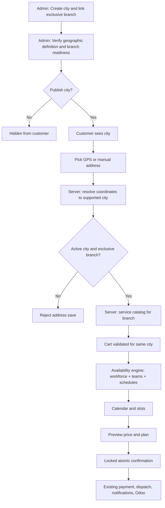

# CITY-01 | وثيقة القرارات والمعمارية المستهدفة

## الهدف التجاري

العميل لا يختار Branch أو Zone أو Coverage Polygon. يختار مدينة مدعومة، ثم عنوانًا دقيقًا داخلها، ثم خدمة/خدمات؛ النظام يستنتج الفرع الحصري للمدينة، ويتحقق من أهلية الخدمة والفنيين والفرق والمواعيد والسعة قبل التأكيد. لا يُقبل حفظ عنوان لمدينة غير متاحة. الإدارة وحدها تحدد المدن الظاهرة وتربط المدينة بفرعها.

## النموذج الإداري

- `City`: كيان مدعوم من إدارة نيراب، `draft|active|paused|retired`، له هوية جغرافية وحدود أو مرجع تحقق معتمد؛ اسم عربي/إنجليزي للعرض فقط.
- `City -> Branch`: تعيين حصري واحد لواحد. الفرع مشتق من المدينة لا من اسم المستخدم أو أقرب فرع.
- `Branch`: هو `Provider` الحالي؛ حالة الاعتماد/النشر/`intake_enabled` والتجهيز التشغيلي تبقى حراسًا فعليين.
- `Catalog Service`: خدمة مركزية؛ `branch_service_permissions` الحالية تتحكم في سماح الإدارة وتفعيل الفرع، مع متطلبات تنفيذ مستقلة.
- `Technician/Team`: موظفو فرع واحد، Skills/Shifts/Leaves/Assignments تفحص فعليًا عند الجدولة.
- `Address`: مرتبط بـ `city_id`, إحداثيات مثبتة، ونتيجة التحقق؛ لا يتطلب ربطًا ثابتًا بالفني أو الحجز.
- `Cart`: مرتبط بسياق مدينة واحدة وعنوان صحيح؛ لا خلط بين مدينتين.
- `Booking`: فرع المدينة ثابت في snapshot المعتمد لكل حجز جديد، مع إعادة تحقق نهائي وضوابط منع التداخل.

## أربع درجات للإتاحة — لا تخلطها

| المستوى | السؤال | متى يُحسب | أثره |
|---|---|---|---|
| `city_bookable` | هل المدينة مفعّلة والفرع يقبل عملًا جديدًا؟ | قائمة المدن والعناوين | إظهار/منع اختيار المدينة وحفظ عنوان جديد |
| `service_configured` | هل الخدمة مُصرح بها ومهيأة بالفرع وبها مؤهلات كافية من حيث التكوين؟ | الكتالوج | خدمة قابلة للاستكشاف/الحجز أو غير قابلة للحجز |
| `time_available` | هل يوجد موعد يحقق مدة وورديات/إجازات/حجوزات/سعة؟ | يوم/ساعة | عرض Slots حقيقية |
| `commit_allowed` | هل الاستحقاق والسعة والسعر والخطة ما زالت صحيحة لحظة الحجز/الدفع؟ | المعاينة النهائية والتأكيد | حجز ذري أو رفض 409/422 دون حجز جزئي |

مهم: غياب موعد اليوم ≠ غياب جاهزية للخدمة. وجود خبير في قائمة الفنيين ≠ توافره الآن. فتح الفرع ≠ صلاحية كل خدمة تلقائيًا.

## التسلسل المعماري

## معمارية التطبيق — Modular Monolith

1. `CityRegistry`: سجلات المدن، حالات التفعيل، حدود المدينة، مسارات النشر/الإيقاف والتدقيق.
2. `CityResolver`: حل موقع العميل إلى مدينة واحدة مؤكدة؛ يعيد سبب رفض قابل للترجمة ولا يفترض اعتماد نص `locality` وحده.
3. `CityBranchResolver`: الفرع الواحد المرتبط بالمدينة والمصرح باستقبال طلبات جديدة؛ fail-closed عند فقد/ازدواج/تعطيل الربط.
4. `CityServiceabilityFacade` (منسق لا محرك جديد): يستعمل `DirectServicePolicy`, `BranchReadinessService`, `ServiceItemRequirements`, `AvailabilityService`, `BranchCapacityPolicy` ويعيد Decision DTO واحدًا بحسب مستوى التحقق.
5. `SingleCityCheckoutAdapter`: يحافظ على `BranchCheckoutService`, `DirectBookingReservationGuard`, snapshots, payment/API contracts؛ يعطل التخطيط متعدد الفروع للحجوزات الجديدة حين feature flag مفعّل دون حذف مسارات legacy.
6. `CalendarAvailability`: يعيد استخدام قرار الإتاحة لنطاق أيام محدود، والنتائج لا تحجز وقتًا ولا تمثل وعدًا ثابتًا.

## قواعد UX

- أول تشغيل: قائمة مدن منشورة مؤهلة + تحديد موقع اختياري بإذن العميل؛ لا يحتاج تسجيل حساب لاستكشاف المدن.
- قبل حفظ عنوان/إضافة سلعة: مدينة مختارة وعنوان تم التحقق منه Server-side.
- عند تبديل المدينة، وضّح تبعات السلة والتسعير والمواعيد، لا تمسح بصمت.
- الصفحة الرئيسية تعرض خدمات فرع المدينة القابلة للتكوين، لا كل خدمات الكتالوج المركزي.
- خدمة انشغل فنيها مؤقتًا: لا تختفي؛ تظهر أيام مستقبلية إن وجدت.
- خدمة بلا فريق مؤهل أو فرع غير جاهز: لا تُقدم كقابلة للحجز، وقد تظهر للاطلاع فقط وفق سياسة المنتج الواضحة.
- `fixed`: أضف للسلة بعد التحقق الأساسي؛ `quote`: طلب عرض سعر مستقل، دون سعر نهائي أو موعد مؤكد وهمي.
- الأخطاء: لا تخلط Offline/Timeout مع `no_slots` أو `city_unsupported`.

## ثوابت مالية وتاريخية

- لا إعادة توزيع صامتة لحجوزات مدفوعة أو مقبولة.
- لا تغيير دون موافقة للـ snapshot/total/discount/wallet/VAT/gateway/Odoo event keys.
- `booking_id` و`bookings[]` القديمتان تبقيان متوافقتين؛ الحجوزات القديمة متعددة الفروع تبقى قابلة للعرض والمتابعة والاسترداد.
- الفروع القديمة التي لها `capacity=0` لا تُرفع سعتها تخمينًا؛ حافظ على التوافق واطلب تهيئة صريحة للفروع الجديدة.
- وقت السعودية `Asia/Riyadh` مرجعي للعرض والحجز؛ لا تولّد مواقيت من timezone جهاز المستخدم.

## لا تفعل

- لا تكتب `where('city_name', 'الرياض')` كأساس أمني أو مالي.
- لا تجعل Places Autocomplete يعيد نص المدينة فيصبح عنوانًا مؤهلًا فورًا.
- لا تجعل وجود فرع في الرياض يثبت القدرة على تنفيذ خدمة معينة غدًا.
- لا تبنِ محرك سعة جديدًا مستقلًا أو تزيل `DispatchEngine`.
- لا تُصلح عرض الخدمات في Flutter فقط وتترك API السلة يقبل الطلب غير المؤهل.
